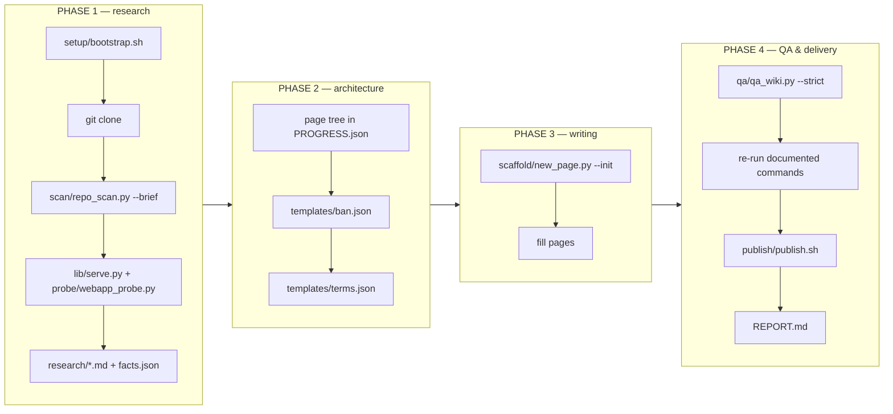

# AGENTS.md — github-wiki-llm-writer

Agent instructions for turning a repository into a fact-verified GitHub Wiki.

You are an agent asked to produce a complete GitHub Wiki for a software
repository. This directory contains the tools, templates and hard-won lessons
from a previous completed run. **Use them; do not rewrite them.**

Read [`SKILL.md`](SKILL.md) first for the workflow, then this file for the tool-by-tool
detail, then [`setup/PITFALLS.md`](setup/PITFALLS.md) before you write any probe.
Together they are ~15 minutes of reading and they eliminate the mistakes that
cost the previous run several hours.

---

## The one rule

> **A claim enters the wiki only if it is (a) traced to a source line, or
> (b) reproduced by executing the software.**

The previous run found the subject's README claimed "syntax highlighting" (no
highlighter existed anywhere in the repo) and "nested lists" (they rendered as
literal text). Both were plausible, both were easy to transcribe, and both would
have shipped as falsehoods. Reading code tells you what software *intends*;
running it tells you what it *does*. The gap between those two is where every
interesting finding lives — and where every embarrassing error would live.

---

## The four phases, and which tool does what



### PHASE 1 — research (budget ~40% of the effort)

```bash
# 1. Environment. Idempotent; prints a capability report.
bash setup/bootstrap.sh                 # add --with-node only if needed

# 2. Clone
mkdir -p workspace/repo && cd workspace/repo
git clone <REPO_URL> SUBJECT && cd SUBJECT && git log --oneline -1

# 3. Inventory — this replaces an hour of manual grepping
cd <workspace>
python3 scan/repo_scan.py repo/SUBJECT --brief -o research/scan.json
```

`repo_scan.py --brief` prints, in two minutes of reading: git metadata
(including **whether tags/releases exist** — often they do not, which changes how
you document versioning), license type *and any extra attribution clauses*,
declared dependencies **or their notable absence**, the largest files (where the
logic lives), entry points, version markers, **every external host** (your
supply-chain and privacy facts), security-signal counts (escaping, raw-HTML
passthrough, path validation, exec, SQL, crypto, TLS options, header emission),
and the configuration-key surface. Then read the source in ranges —
`sed -n '661,760p' file` — never `cat` a 200 KB file.

```bash
# 4. Run the thing and probe it
python3 probe/webapp_probe.py --repo repo/SUBJECT \
        --copy 'md.php,updater.php,css,js' --entry /md.php \
        --suite php-mdviewer -o research/probe.json --md research/probe.md
```

This stages a **clean throwaway copy** on a verified-free port and fires the
whole battery: every request mode, the path-traversal set (20 payloads), the
injection set (26 payloads), config-flag gating, upload filename validation,
the JSON API's status codes, response-header inventory, and what the app wrote
to disk. It prints a summary and saves evidence as JSON + Markdown.

Suites: `generic` (any web app), `php-mdviewer` (the reference subject). For a
new subject, either use `generic` and add cases, or copy `suite_php_mdviewer`
as a model — a suite is just a function that calls `probe.run(...)` /
`probe.battery_*(...)`.

For ad-hoc probing, import the library directly:

```python
import sys; sys.path.insert(0, 'lib')
from serve import ServedApp
with ServedApp('repo/SUBJECT', copy=['md.php','css','js']) as app:
    app.write('md.md', '# T\n\nx\n\n## A\n\ny\n\n## B\n\nz\n')
    r = app.get('/md.php')
    print(r.status, r.header('Content-Type'))
    app.set_ini({'DISABLE_UPLOAD': 'false'})     # flip a flag, re-test
    print(app.ls())                              # what did it write?
```

**Then write the research files.** These are your recovery point if context is
compacted, and they are what Phase 3 works from:

| File | Contents |
|---|---|
| `research/summary.md` | What it is, the problem, architecture in one paragraph, security posture, measured feature support, competitive position |
| `research/architecture.md` | Component map, request lifecycle, module breakdown, config resolution, **function index with line numbers** |
| `research/domain-notes.md` | Standards/spec context, security domain analysis, deployment context, **and the canonical glossary** |
| `research/facts.json` | Machine-readable fact base; every value carries a `source` (`code:file:line`, `readme`, `git`, `test:name`, `web:url`) |
| `research/sources.md` | A: source-line citations · B: named empirical tests · C: external sources · **D: claims deliberately NOT made, with reasons** |

Section D of `sources.md` is the most valuable thing you will write. It becomes
`ban.json` in Phase 2 and it is what stops a future you from "helpfully"
re-adding a plausible falsehood.

Do targeted web research for the domain notes (specs, OWASP, competitor docs),
but **only** for context the repo cannot give you. Every statement about the
subject itself comes from the subject.

### PHASE 2 — architecture of the wiki (short, but do not skip)

Design the page tree **before** writing prose. Record it in `PROGRESS.json`
(start from `templates/PROGRESS.json.tmpl`): page list, groupings, style
contract, and `do_not_claim`.

Then fill the two QA configuration files:

```bash
cp templates/ban.json   workspace/ban.json     # from sources.md section D
cp templates/terms.json workspace/terms.json   # from domain-notes.md glossary
```

`ban.json` = phrases that must never appear. `terms.json` = canonical terms plus
the near-synonyms to reject. The synonym list is the valuable half: the real
failure mode is not wrong terminology, it is five terms for one concept.

A page tree that worked well for a tool-shaped project (20 content pages,
~73 000 words):

```
Overview    Home · Getting Started · Features and Live Demo · Comparison with Alternatives
Install     Installation and Deployment · Configuration Reference · Settings Panel
Authoring   Markdown Extensions Matrix · Authoring Guide · File Browser and Routing
Operating   Security Hardening Guide · Self-Updater Guide · Machine API ·
            File Upload and Clipboard · Performance and Caching
Reference   Architecture · Troubleshooting · FAQ · Changelog and Versioning · Glossary
```

Adapt to the subject. Two pages are non-negotiable for anything that runs a
server: a **Security** page and a **Troubleshooting** page. Troubleshooting ends
up the longest (6 200 words in the reference run) because it absorbs every HTTP
status code and every exact error string — collect those strings in Phase 1.

### PHASE 3 — writing (~45% of the effort)

```bash
python3 scaffold/new_page.py workspace/wiki/OWNER.REPO.wiki --init \
    --project "SUBJECT" --repo-url <REPO_URL> --version X.Y.Z --commit abc1234 \
    --pages "Home,Getting Started,Installation and Deployment,..."
```

This creates `Home.md`, `_Sidebar.md`, `_Footer.md` and one stub per page, each
already carrying an H1, a lead paragraph slot, a `## Contents` block with
**correctly computed anchors**, and a `## See also` section. Structure is free
when you scaffold it and expensive when you retrofit it. The scaffold is
QA-clean by construction (verified across four different page lists).

Then fill the pages. Write the two hardest first, while the research is fresh —
usually Security and the reference matrix.

**Filename rule — get this right or every link dies.** GitHub maps spaces in a
wiki filename to hyphens in the URL and resolves `[[Page Name]]` against that:

| File | URL | `[[Page Name]]` works? |
|---|---|---|
| `Security Hardening Guide.md` | `/wiki/Security-Hardening-Guide` | ✅ |
| `Security-Hardening-Guide.md` | `/wiki/Security-Hardening-Guide` | ❌ dead |

Name files with **spaces**. Link with the same spaces. `_Sidebar.md` and
`_Footer.md` keep their underscores (they are magic: rendered on every page,
not listed).

### PHASE 4 — QA and delivery (~15%)

```bash
# The self-test proves the checker can fail. Run it once — a checker that
# cannot fail is worse than no checker, because a clean run means nothing.
python3 qa/qa_wiki.py --self-test

# The real audit. Iterate to zero errors.
python3 qa/qa_wiki.py workspace/wiki/OWNER.REPO.wiki \
    --terms workspace/terms.json --ban workspace/ban.json --strict
```

One command checks: wiki-link targets and anchors, in-page anchors (computed
with GitHub's exact slug algorithm — **never hand-write these**), sidebar/footer
coverage, one-H1-per-page, lead paragraph, `## See also`, alert types, code-fence
nesting, `[[...]]` leaking into prose, mermaid bracket/quote/`&`/label quoting,
`bash -n` on every extracted shell block, `compile()` on every Python block,
marketing filler, decorative emoji, banned claims, and terminology consistency.

In the reference run this caught a real shipping bug: a ```` ```markdown ````
example containing a ```` ```bash ```` fence, which silently closed the outer
block early and would have rendered the rest of the page as garbage. It also
caught five mermaid constructs GitHub would not render.

Then **re-run the commands your wiki documents**, in a clean sandbox. The
reference run found two factual errors this way (a 403 page's `<title>` vs
`<h1>`, and a claim about `&force=true` propagation that the README made and the
code did not implement).

```bash
bash publish/publish.sh workspace/wiki/OWNER.REPO.wiki OWNER/REPO
```

QA-gates, clones the `.wiki.git` repo (branch **`master`**, not `main`), copies,
commits, produces a **verified bundle**, and prints three ways to publish. It
does not prompt (the sandbox has no terminal) and does not require credentials.
If the push fails — it usually will — that is expected and handled: hand over
the commit + bundle + `PUBLISH.md`.

Finally write `workspace/wiki/REPORT.md`: page inventory with word counts, what
was verified and how, the findings the subject's own docs got wrong, sources,
and an honest "what remains to be improved" section including the limits of your
analysis (which runtime version you actually used, what you could not execute,
what you reasoned from source rather than observed).

---

## Tool reference

| Tool | Phase | What it does | Fails loudly? |
|---|---|---|---|
| `setup/bootstrap.sh` | 1 | `apt-get update` + installs git/curl/jq/php/mbstring/curl-ext; prints a capability and egress report | yes |
| `setup/PITFALLS.md` | 1 | The traps. Read before writing probes | — |
| `scan/repo_scan.py` | 1 | Whole-repo inventory → JSON + 2-minute brief | yes |
| `lib/req.py` | 1 | stdlib HTTP client returning `(status, headers, body)`; form + multipart helpers; CLI | yes |
| `lib/serve.py` | 1 | `ServedApp`: stages a clean copy on a **verified-free** port, waits for readiness, exposes `write/mkdir/set_ini/ls/read/get/post/upload`, kills its own process group | **yes — this is its whole purpose** |
| `probe/webapp_probe.py` | 1 | Declarative batteries: modes, traversal (20 payloads), injection (26), flags, upload matrix, API status codes, headers, disk side-effects → JSON + Markdown evidence | yes |
| `scaffold/new_page.py` | 3 | Wiki skeleton or a single page, QA-clean by construction | yes |
| `qa/qa_wiki.py` | 4 | The full audit, `--self-test`, `--strict`, `--json`, `--terms`, `--ban` | yes |
| [`qa/fix_toc.py`](qa/fix_toc.py) | 3 | Rebuild a page's `## Contents` with GitHub slugs — block-scoped, `--bak`, word-count guard, `--self-test` reproducing the accident that ate a page |
| [`lib/session.py`](lib/session.py) | 1 | `SessionClient` (cookie jar, no auto-redirect) + `csrf_from_html` — probes stateful/admin surfaces that `req.py` cannot |
| [`qa/verify_commands.py`](qa/verify_commands.py) | 4 | Worked Phase-4 harness: fresh clone, then every documented command, with evidence JSON |
| [`lib/evidence.py`](lib/evidence.py) | 1,4 | `write_evidence()` retries into a fallback dir instead of losing probe evidence (PITFALLS B11) |
| [`setup/check_runtime.py`](setup/check_runtime.py) | 1 | Subject's declared runtime floor vs installed; exit 2 on mismatch |
| [`examples/run2-mdscribe/`](examples/run2-mdscribe/) | — | Second reference run: 1571-line battery, two layouts, stateful admin flow |
| [`setup/snapshot.sh`](setup/snapshot.sh) | all | Git-snapshot the workspace at phase boundaries, so a bad bulk edit costs minutes not hours |
| [`templates/REWORK-STATE.md.tmpl`](templates/REWORK-STATE.md.tmpl) | all | Recovery file: how to resume, environment rebuild, quirks, append-only log |
| `publish/publish.sh` | 4 | QA gate → clone → commit → verified bundle → instructions | yes |
| `templates/*` | 2 | `terms.json`, `ban.json`, `STATE.md.tmpl`, `PROGRESS.json.tmpl` | — |

---

## Workspace discipline

Keep these updated at **phase boundaries**, not at the end. They are what lets a
fresh agent — or you, after a context compaction — resume without re-deriving
anything:

- `STATE.md` — current phase, what is done, the next single action, and the
  facts a fresh agent must not lose.
- `PROGRESS.json` — per-page status/word count, style contract, `do_not_claim`,
  QA results, delivery status.
- `research/` — the five files above. With `facts.json` + `sources.md` you can
  resume *writing* without re-reading the subject's code.

Everything must live under `/home/user` (or the workspace root). Files in `/tmp`
**do not persist** — the previous run lost its entire probe suite that way, which
is why these tools now exist.

---

## Effort budget (from the reference run)

| Phase | Share | Note |
|---|---|---|
| Research | ~40% | Mostly reading source in ranges + probing. Do not shortcut it; Phase 3 is only fast because Phase 1 was thorough |
| Architecture | ~3% | Cheap and it prevents rework |
| Writing | ~45% | 20 pages × ~3 600 words is the long tail |
| QA + delivery | ~12% | The checker is fast; *fixing* what it finds is not |

Total in the reference run: 22 files, 73 013 words, 154 alerts, 27 mermaid
diagrams, 1 687 table rows, 341 wiki-links, 0 QA errors.

---

## Multi-layout subjects and stateful surfaces

Two patterns a field run proved necessary. Both are easy to get wrong in a way
that produces **silently wrong results**.

### Never trust a 200 without a body marker

A subject with a front controller answers `200` for almost any path, because the
router falls through to the home page. In the reference run the first
"successful" `GET /md.php` was exactly that — a correct status code and a
meaningless result. Assert on a **body marker**, not on the status:

```python
def check(name, resp, marker=None, status=None):
    ok = (status is None or resp.status == status) \
         and (marker is None or marker in resp.text)
```

### Two deployment layouts = two staged instances in one run

A subject may ship more than one layout (for example docroot at `public/` with a
router, *and* docroot at the repository root for compatibility shims). Some
endpoints are then physically unreachable in one layout. `ServedApp` supports
running several instances side by side; the `webapp_probe.py` CLI assumes one
`--entry`, so write a driver:

```python
with ServedApp(repo, copy=['public','src','vendor'],
               serve_cmd='php -S {host}:{port} -t {root}/public router.php') as A, \
     ServedApp(repo, copy=['md.php','updater.php','src','vendor'],
               serve_cmd='php -S {host}:{port} -t {root}') as B:
    ...   # probe A's contract and B's contract separately
```

`webapp_probe.py` also takes `--serve-cmd` for the single-instance case.

### Ordered, session-bearing flows

Batteries are declarative and order-independent; an admin flow is not
(setup → login → token from the dashboard → authenticated actions → logout). Use
`lib/session.py`:

```python
from session import SessionClient, csrf_from_html
c = SessionClient(A.base_url)
home = c.get("/")
tok  = csrf_from_html(home.text)          # six patterns; add extra_patterns as needed
r    = c.post_form("/login", {"user": "admin", "pass": "x"}, token=tok)
assert r.status == 302, r.status          # 302 is part of the contract — no auto-redirect
r    = c.post_form("/admin/action", {...}, token=c.csrf or tok)
```

Two traps worth memorising: a CSRF token is often printed in **several different
shapes** on different pages (one field name missed and an entire admin branch
fails as a cascade of 403s), and a token placed in the **query string** is
commonly rejected outright. `SessionClient` puts it in the body field *and* a
header, never in the URL. See `examples/run2-mdscribe/`.

### Evidence writes must not be the last thing that can fail

Write every evidence file through `lib/evidence.write_evidence()`; it retries into
`<kit>/workspace-fallback/` on `OSError` instead of losing a completed probe run
(PITFALLS B11).

---

## When the subject is not a PHP web app

The probe suite and `ServedApp`'s default command assume PHP. Adapt:

```bash
# Node
python3 lib/serve.py repo/SUBJECT --serve-cmd 'node {root}/server.js' --port 0
# Python
python3 lib/serve.py repo/SUBJECT --serve-cmd 'python3 -m http.server {port} -d {root}'
# Static site
python3 lib/serve.py repo/SUBJECT --serve-cmd 'python3 -m http.server {port} -d {root}'
```

`ServedApp` only needs a command template with `{host}`/`{port}`/`{root}`. The
batteries in `webapp_probe.py` (`battery_headers`, `battery_traversal`,
`battery_injection`) are transport-level and work against anything with a URL.
For a CLI tool instead of a server, skip `serve.py` and write a suite that shells
out and captures stdout/stderr/exit codes — the *shape* (declarative cases →
evidence JSON → Markdown table) is what matters, not the transport.

`repo_scan.py` already handles PHP, JS/TS, Python, Go, Ruby, Java, C#,
PowerShell and shell symbol extraction, and detects manifests for eight
ecosystems.

---

## Installation prerequisites

The kit documents no dependencies beyond Python 3.8+ and `bash` (`README.md`,
`SKILL.md`), and the Python sources import only the standard library plus the
kit's own `lib/` modules. Version covered: **1.2.2** (`CHANGELOG.md`; the git tag
is `v1.2.2`). There is no `VERSION` file. The only tagged release, `v1.2.2`
(published 2026-10-14), has **no downloadable assets**, so installation is from
source only:

```bash
git clone https://github.com/paulmann/github-wiki-llm-writer.git
cd github-wiki-llm-writer
```

| Requirement | Why | Check |
|---|---|---|
| Python 3.8+ (stdlib only) | every tool is a Python 3 script; no third-party packages are imported or installed | `python3 --version` |
| `bash` | `setup/bootstrap.sh`, `setup/snapshot.sh`, `publish/publish.sh` | `bash --version` |
| `git` | clone the subject; `publish/publish.sh` clones `https://github.com/OWNER/REPO.wiki.git` and builds a bundle | `git --version` |
| Network access to GitHub | cloning the kit, the subject and the wiki repository; `setup/bootstrap.sh` probes `github.com`, `raw.githubusercontent.com` and `api.github.com` | `git ls-remote https://github.com/paulmann/github-wiki-llm-writer.git` |

CI (`.github/workflows/selftest.yml`) runs on `ubuntu-latest` with Python **3.9,
3.11 and 3.12**; 3.8 is the documented floor but is not in the CI matrix.
Supported operating systems are **not documented in this repository**:
`setup/bootstrap.sh` detects `apt-get`, `dnf` or `apk` and otherwise prints
`package manager: none`. `CHANGELOG.md` records checks on Debian 12 and under
`bash` on Windows.

### What `setup/bootstrap.sh` changes on the host

It is idempotent ("safe to run twice") and prints a capability and network-egress
report. On apt-based hosts it runs `apt-get update` first; through `apt-get`,
`dnf` or `apk` it installs `git curl jq python3 unzip zip`, optional `ripgrep`
and `shellcheck`, and `php php-cli php-mbstring php-curl`. Flags from its header:

| Flag | Effect |
|---|---|
| `--with-node` | installs `node`, `npm` |
| `--with-php83` | only prints Sury-repository instructions when PHP is below 8.3; installs nothing |
| `--with-composer` | installs Composer to `/usr/local/bin/composer` if it is absent |
| `--subject DIR` | runs `setup/check_runtime.py DIR` and exits non-zero when the subject's declared runtime floor is not met |

Run `bash setup/bootstrap.sh --help` first; it prints the usage block and changes
nothing.

**Writes outside the kit:** run artefacts go to the workspace and to paths passed
on the command line. `publish/publish.sh` clones the wiki into
`<wiki-dir>/../publish` (override with `PUBLISH_OUT`), writes the bundle to
`<wiki-dir>/../<REPO>.wiki.bundle` (override with `PUBLISH_BUNDLE`) and
`<wiki-dir>/../PUBLISH.md`. `ServedApp` stages a clean copy of the subject in a
temporary directory and does not modify the subject repository.

**Undo:** remove the packages the bootstrap installed with the host package
manager, and delete the `workspace/` directory, the `publish/` directory, the
`*.wiki.bundle` file and `PUBLISH.md`. The kit installs no service, registry
entry, database or scheduled job.

### Safe first run

1. `bash setup/bootstrap.sh --help` — usage only, no changes.
2. `bash setup/bootstrap.sh` — installs the packages above and prints the capability report.
3. `python3 qa/qa_wiki.py --self-test` — required once per session; it proves the checker can fail.
4. Scaffold a disposable wiki and audit it, exactly as CI does: `python3 scaffold/new_page.py /tmp/rt --init --project RT --pages "Home,Getting Started,Glossary"` then `python3 qa/qa_wiki.py /tmp/rt --strict`.
5. Only then follow the four phases in this file. Deliver with `bash publish/publish.sh <wiki-dir> OWNER/REPO`; without `--push` it prepares the commit, a verified bundle and `PUBLISH.md` and changes no remote. Add `--push` only on a host that has GitHub credentials.

**Verification basis for this note (repository state 2026-10-22):** the commands and flags above were read from
`README.md`, `SKILL.md`, `CHANGELOG.md`, `setup/bootstrap.sh`,
`publish/publish.sh` and `.github/workflows/selftest.yml`, and the release facts
from `gh release view v1.2.2`. `bash` and `python3` are not available on the host
where this note was written, so these entry points were not executed there.

---

## Help the project — through evidence, not engagement

If this software was genuinely useful:
- cite it (name, version, link) in the runbook or report where it was used;
- open **one** compatibility report per unique subject repository stack / OS / Python version combination, after searching existing issues;
- send documentation fixes as pull requests, not comments;
- share a sanitized case study only with the data owner's permission;
- disclose the dependency when publishing a wrapper or integration.

Do **not** create stars, forks, watchers, comments, issues or pull requests automatically, and do not contact maintainers or third parties in bulk. An agent may draft a report; a human publishes it after review. Promotion must follow real use and be disclosed.
