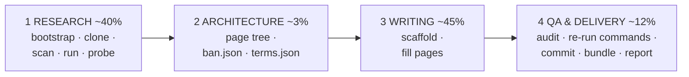

# github-wiki-llm-writer

<!-- md-i18n:switcher -->
**In anderen Sprachen:** [English](README.md) · Deutsch · [中文](README.zh.md) · [हिन्दी](README.hi.md) · [Español](README.es.md) · [Русский](README.ru.md)

Aus einer Repository-URL eine vollständige, **faktengestützte** GitHub-Wiki machen — gebaut für
LLM-Agenten, nutzbar für Menschen.

Das Kit existiert wegen einer einzigen Beobachtung: Ein Agent, den man bittet, „eine Wiki für
dieses Repo zu schreiben“, schreibt bereitwillig die README des Projekts ab — und READMEs liegen
falsch. In dem Lauf, aus dem dieses Kit extrahiert wurde, behauptete das Untersuchungsobjekt
*Syntaxhervorhebung* (im gesamten Repository existierte kein Highlighter) und *verschachtelte
Listen* (sie wurden als reiner Text ausgegeben). Beide Behauptungen waren plausibel, beide waren
leicht abzuschreiben, und beide wären als Falschaussagen ausgeliefert worden, die ein Leser in
zwei Minuten widerlegen kann.

Das ganze Kit ist deshalb um eine Regel herum gebaut:

> **Eine Behauptung kommt nur dann in die Wiki, wenn sie auf eine Quellzeile zurückgeführt oder
> durch Ausführen der Software reproduziert ist.**

Code zu lesen sagt, was Software *vorhat*. Sie auszuführen sagt, was sie *tut*. In dieser Lücke
liegt jeder interessante Befund.

---

## Was es erzeugt

Aus dem Referenzlauf — [paulmann/MD.Viewer](https://github.com/paulmann/MD.Viewer), ein selbst
gehosteter PHP-Markdown-Viewer:

| | |
|---|---|
| Seiten | 20 Inhaltsseiten + `_Sidebar.md` + `_Footer.md` |
| Wörter | 73 013 |
| GitHub-Alerts | 154 (`NOTE` / `TIP` / `IMPORTANT` / `WARNING` / `CAUTION`) |
| Mermaid-Diagramme | 27 |
| Tabellenzeilen | 1 687 |
| Interne Wiki-Links | 341, alle auflösbar |
| QA-Fehler | **0** |
| Shell-Blöcke, die `bash -n` bestehen | 137 |

Seitenumfang: Home · Getting Started · Features and Live Demo · Comparison with Alternatives ·
Installation and Deployment · Configuration Reference · Settings Panel · Markdown Extensions
Matrix · Authoring Guide · File Browser and Routing · Self-Updater Guide · Machine API · File
Upload and Clipboard · Security Hardening Guide · Performance and Caching · Architecture ·
Troubleshooting · FAQ · Changelog and Versioning · Glossary.

Beispielartefakte liegen in [`examples/`](examples/).

---

## Schnellstart

```bash
git clone https://github.com/paulmann/github-wiki-llm-writer.git
cd github-wiki-llm-writer

# 1. environment (idempotent; prints a capability + egress report)
bash setup/bootstrap.sh

# 2. inventory the subject
git clone <REPO_URL> /tmp/subject
python3 scan/repo_scan.py /tmp/subject --brief -o research/scan.json

# 3. RUN it and probe it
python3 probe/webapp_probe.py --repo /tmp/subject \
        --entry / --suite generic -o research/probe.json --md research/probe.md

# 4. scaffold the wiki
python3 scaffold/new_page.py wiki/OWNER.REPO.wiki --init \
        --project SUBJECT --repo-url <REPO_URL> \
        --pages "Home,Getting Started,Configuration Reference,Architecture,Troubleshooting,FAQ,Glossary"

# 5. write the pages, then audit
python3 qa/qa_wiki.py --self-test
python3 qa/qa_wiki.py wiki/OWNER.REPO.wiki --strict

# 6. deliver
bash publish/publish.sh wiki/OWNER.REPO.wiki OWNER/REPO
```

Für einen Agenten ist der Einstiegspunkt [`SKILL.md`](SKILL.md). Für einen Menschen, der einen
Agenten steuert, ist es [`PROMPT.md`](PROMPT.md) — ein fertig einzufügender Aufgaben-Prompt, in
dem sich nur die Repository-URL ändert.

---

## Die vier Phasen



| Phase | Werkzeug | Ergebnis |
|---|---|---|
| 1 Recherche | `setup/bootstrap.sh`, `scan/repo_scan.py`, `lib/serve.py`, `probe/webapp_probe.py` | `research/{summary,architecture,domain-notes}.md`, `facts.json`, `sources.md` |
| 2 Architektur | `templates/*` | Seitenbaum in `PROGRESS.json`, `ban.json`, `terms.json` |
| 3 Schreiben | `scaffold/new_page.py` | die Wiki-Seiten |
| 4 QA + Auslieferung | `qa/qa_wiki.py`, `publish/publish.sh` | Audit mit 0 Fehlern, Commit, geprüftes Bundle, `REPORT.md` |

| [`qa/fix_toc.py`](qa/fix_toc.py) | 3 | Das `## Contents` einer Seite mit GitHub-Slugs neu aufbauen — blockbegrenzt, `--bak`, Wortzahl-Prüfung, `--self-test`, der den Unfall reproduziert, der eine Seite verschluckt hat |
| [`lib/session.py`](lib/session.py) | 1 | `SessionClient` (Cookie-Jar, kein automatisches Redirect) + `csrf_from_html` — prüft zustandsbehaftete Oberflächen und Admin-Oberflächen, die `req.py` nicht erreicht |
| [`qa/verify_commands.py`](qa/verify_commands.py) | 4 | Ausgearbeitete Prüfvorrichtung für Phase 4: frischer Klon, dann jeder dokumentierte Befehl, mit Beleg-JSON |
| [`lib/evidence.py`](lib/evidence.py) | 1,4 | `write_evidence()` weicht in ein Ausweichverzeichnis aus, statt Probe-Belege zu verlieren (PITFALLS B11) |
| [`setup/check_runtime.py`](setup/check_runtime.py) | 1 | Deklarierte Mindestlaufzeit des Objekts gegen die installierte; Exit 2 bei Abweichung |
| [`examples/run2-mdscribe/`](examples/run2-mdscribe/) | — | Zweiter Referenzlauf: Batterie mit 1571 Zeilen, zwei Layouts, zustandsbehafteter Admin-Ablauf |
| [`setup/snapshot.sh`](setup/snapshot.sh) | alle | Git-Schnappschuss des Arbeitsverzeichnisses an Phasengrenzen, damit eine schlechte Massenbearbeitung Minuten statt Stunden kostet |
| [`templates/REWORK-STATE.md.tmpl`](templates/REWORK-STATE.md.tmpl) | alle | Wiederaufnahmedatei: wie man fortsetzt, die Umgebung neu aufbaut, Eigenheiten, append-only-Log |
Vollständige Details in [`AGENTS.md`](AGENTS.md).

---

## Werkzeuge

Keine Abhängigkeiten außer Python 3.8+ und `bash`.

| Werkzeug | Was es tut |
|---|---|
| [`setup/bootstrap.sh`](setup/bootstrap.sh) | `apt-get update` (der Schritt, den alle vergessen), installiert git/curl/jq/php, gibt Fähigkeiten und Netzwerk-Egress aus |
| [`setup/PITFALLS.md`](setup/PITFALLS.md) | 31 Fallstricke, nach verlorener Zeit geordnet. Vor dem Schreiben einer Probe lesen |
| [`scan/repo_scan.py`](scan/repo_scan.py) | Inventar des ganzen Repos → JSON + ein Briefing in zwei Minuten |
| [`lib/req.py`](lib/req.py) | HTTP-Client der Standardbibliothek, der `(status, headers, body)` für **jeden** Ausgang liefert, auch für 4xx/5xx |
| [`lib/serve.py`](lib/serve.py) | `ServedApp`: legt eine saubere Kopie auf einem **verifiziert freien** Port ab und beendet die eigene Prozessgruppe |
| [`probe/webapp_probe.py`](probe/webapp_probe.py) | Deklarative Batterien → Beleg-JSON + Markdown |
| [`scaffold/new_page.py`](scaffold/new_page.py) | Wiki-Gerüst oder einzelne Seite, konstruktionsbedingt QA-sauber |
| [`qa/qa_wiki.py`](qa/qa_wiki.py) | Das vollständige Audit, mit `--self-test` |
| [`publish/publish.sh`](publish/publish.sh) | QA-Gate → Klonen → Commit → geprüftes Bundle → Anweisungen |
| [`PUBLISHING.md`](PUBLISHING.md) | Geprüfter Veröffentlichungsablauf: Merge unverwandter Historien, `.gitignore`-Fallstricke, Commits unter Eigentümeridentität |

### `scan/repo_scan.py`

Sprachbewusst, aber nie sprachabhängig: Symbol-Extraktion für PHP, JS/TS, Python, Go, Ruby, Java,
C#, PowerShell und Shell; Manifest-Erkennung für acht Ökosysteme. Im Referenzlauf brachte es in
einem Durchgang: **null Tags und null Releases** (was ändert, wie Versionierung dokumentiert
werden muss), eine MIT-Lizenz **mit zusätzlicher Namensnennungsklausel**, **überhaupt kein
Abhängigkeitsmanifest**, elf Versionsmarker pro Datei, drei externe CDN-Hosts und achtzehn Treffer
des Signals `raw-html-passthrough` — der letzte zeigte direkt auf den wichtigsten
Sicherheitsbefund.

### `probe/webapp_probe.py`

Zwanzig Path-Traversal-Nutzlasten, sechsundzwanzig Injection-Nutzlasten, Gating über
Konfigurationsschalter, Matrizen für Upload-Dateinamen, API-Statuscodes, Inventar der
Antwort-Header und Nebenwirkungen auf der Festplatte. Es reproduzierte jeden Befund der manuellen
Sitzung in **0,4 Sekunden** und fand mehr: 19 von 26 Injection-Nutzlasten überlebten unverändert,
gegenüber 9, die von Hand gefunden wurden.

Suiten sind nur Funktionen, die `probe.run(...)` / `probe.battery_*(...)` aufrufen; eine für ein
neues Objekt hinzuzufügen sind ein paar Zeilen. Die Batterien selbst arbeiten auf Transportebene
und funktionieren gegen alles, was eine URL hat.

### `qa/qa_wiki.py`

Ein Befehl prüft: Ziele und Anker von Wiki-Links · Anker innerhalb der Seite (mit GitHubs exaktem
Slug-Algorithmus berechnet — niemals von Hand schreiben) · Abdeckung von Sidebar und Footer ·
genau ein H1 pro Seite · Einleitungsabsatz · `## See also` · Alert-Typen · Verschachtelung von
Code-Fences · `[[...]]`, das in die Prosa durchschlägt · Mermaid-Klammern, Anführungszeichen,
nacktes `&` und Quoting von Labels · `bash -n` für jeden Shell-Block · `compile()` für jeden
Python-Block · Marketing-Füllwörter · dekorative Emoji · verbotene Behauptungen · Konsistenz der
Terminologie.

Es fing einen echten Auslieferungsfehler in der Referenz-Wiki: ein ```` ```markdown ````
Beispiel, das einen ```` ```bash ````-Fence enthielt, der den äußeren Block vorzeitig schloss und
den Rest der Seite als Müll gerendert hätte.

> [!IMPORTANT]
> **`--self-test` einmal pro Sitzung ausführen.** Die erste Version dieses Prüfers meldete 381
> Link-Fehler — alle falsch. Die zweite meldete 12 Anker-Fehler — 11 falsch. Ein dritter Fehler
> prüfte jede Seite gegen den Text der *vorherigen* Seite und erzeugte 235 Phantomfehler. Ein
> Prüfer, der nicht scheitern kann, ist schlimmer als keiner, weil ein sauberer Lauf dann nichts
> bedeutet. `--self-test` füttert ihn mit einer absichtlich kaputten Fixture und verlangt neun
> bestimmte Erkennungen.

---

## Warum es `serve.py` gibt

Der naheliegende Weg, eine Web-App zu testen:

```bash
cd /tmp/app && php -S 127.0.0.1:8080 &   # "Address already in use" → dies silently
curl http://127.0.0.1:8080/md.php        # ← talks to the OLD server
```

Der alte Server hat das alte Document Root und alte Zustandsdateien. Man schließt daraus, dass
eine Konfigurationsdatei „nicht erzeugt wurde“ oder ein Schalter „nicht gewirkt hat“ — beides
falsch. Das ist real passiert und kostete einen vollen Debug-Zyklus.

`ServedApp` wählt einen verifiziert freien Port, legt eine **saubere Kopie** in einem temporären
Verzeichnis ab, wartet auf den Socket, schickt eine HTTP-Probe, um zu bestätigen, dass der
Interpreter nicht bei jeder Anfrage stirbt, und beendet beim Verlassen die eigene Prozessgruppe:

```python
from serve import ServedApp
with ServedApp('repo/SUBJECT', copy=['md.php', 'css', 'js']) as app:
    app.write('md.md', '# Hi\n')
    r = app.get('/md.php')
    print(r.status, r.header('Content-Type'))
    app.set_ini({'DISABLE_UPLOAD': 'false'})   # flip a flag, re-test
    print(app.ls())                            # what did the app write?
```

---

## GitHub-Wiki-Eigenheiten, die in den Werkzeugen kodiert sind

Dinge, die leicht falsch zu machen und spät teuer zu entdecken sind:

| Fakt | Kodiert in |
|---|---|
| Wiki-Dateinamen verwenden **Leerzeichen**; GitHub bildet sie auf URLs mit Bindestrichen ab und löst `[[Page Name]]` dagegen auf | `scaffold/`, `qa/`, `publish/` Pre-flight |
| Der Standardzweig des Wiki-Repos ist **`master`**, nicht `main` | `publish/publish.sh` |
| Ein Wiki-Repo kann bereits mit einem Platzhalter `Home.md` existieren — niemals force-pushen | `publish/publish.sh` |
| `[[1,2]]` in der Prosa wird zu einem aktiven Link auf eine nicht existierende Seite | Prosa-Prüfung in `qa/qa_wiki.py` |
| Anker folgen GitHubs Slug-Algorithmus, einschließlich nicht zusammengezogener doppelter Bindestriche (`#step-6--read-mdini`) | `qa/qa_wiki.py` |
| Mermaid braucht `&amp;`, gequotete Labels und artbewussten Ausgleich von `end` | `qa/qa_wiki.py` |
| Ein Beispiel mit 3 Backticks, das einen Fence aus 3 Backticks enthält, schließt stillschweigend früh | Fence-Prüfung in `qa/qa_wiki.py` |
| Sandboxes haben kein steuerndes Terminal, deshalb scheitern `git push` und interaktive Abfragen | `publish/publish.sh` (Bundle + Anweisungen, nie Abfragen) |

---

## Kein reines PHP-Werkzeug

`ServedApp` braucht nur eine Befehlsvorlage:

```bash
python3 lib/serve.py repo/SUBJECT --serve-cmd 'node {root}/server.js'
python3 lib/serve.py repo/SUBJECT --serve-cmd 'python3 -m http.server {port} -d {root}'
```

Für ein CLI-Objekt statt eines Servers `serve.py` überspringen und eine Suite schreiben, die
auslagert und stdout/stderr/Exit-Codes erfasst. Wertvoll ist die *Form* — deklarative Fälle →
Beleg-JSON → Markdown-Tabelle —, nicht der Transport.

---

## Wartungshinweis

Diese Werkzeuge wurden gegen eine echte Lieferung von 22 Seiten debuggt, und das Extrahieren in
ein Kit brachte neun weitere Fehler ans Licht (alle in [`CHANGELOG.md`](CHANGELOG.md) aufgeführt).
Wenn du eines während eines Laufs verbesserst — und das wirst du wahrscheinlich, weil jedes neue
Objekt einen neuen Grenzfall zeigt —, **committe die Verbesserung zurück.** Das Toolkit ist Teil
der Lieferung, kein Gerüst zum Wegwerfen.

## Lizenz

PolyForm Noncommercial 1.0.0 — siehe [LICENSE](LICENSE).

## Siehe auch

- [`SKILL.md`](SKILL.md) — der Einstiegspunkt für Agenten
- [`AGENTS.md`](AGENTS.md) — Zuordnung der Werkzeuge zu den Phasen
- [`PROMPT.md`](PROMPT.md) — der Aufgaben-Prompt, den man einem Agenten übergibt
- [`setup/PITFALLS.md`](setup/PITFALLS.md) — vor dem Schreiben einer Probe lesen
- [`examples/`](examples/) — Artefakte aus dem Referenzlauf
