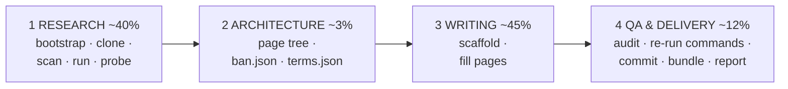

# github-wiki-llm-writer

<!-- md-i18n:switcher -->
**En otros idiomas:** [English](README.md) · [Deutsch](README.de.md) · [中文](README.zh.md) · [हिन्दी](README.hi.md) · Español · [Русский](README.ru.md)

Convertir una URL de repositorio en una wiki de GitHub completa y **verificada con hechos** — pensada
para agentes LLM, utilizable por personas.

El kit existe por una sola observación: a un agente al que se le pide «escribe una wiki para este
repo» le bastará con transcribir el README del propio proyecto, y los README se equivocan. En la
ejecución de la que se extrajo esto, el sujeto afirmaba tener *resaltado de sintaxis* (no existía
ningún resaltador en todo el repositorio) y *listas anidadas* (se renderizaban como texto literal).
Ambas afirmaciones eran verosímiles, ambas eran fáciles de copiar, y ambas se habrían publicado como
falsedades que un lector puede refutar en dos minutos.

Por eso todo el kit está organizado alrededor de una regla:

> **Una afirmación entra en la wiki solo si se rastrea hasta una línea de código fuente, o se
> reproduce ejecutando el software.**

Leer el código dice lo que el software *pretende*. Ejecutarlo dice lo que *hace*. En esa brecha vive
todo hallazgo interesante.

---

## Qué produce

De la ejecución de referencia — [paulmann/MD.Viewer](https://github.com/paulmann/MD.Viewer), un visor
de Markdown en PHP autoalojado:

| | |
|---|---|
| Páginas | 20 páginas de contenido + `_Sidebar.md` + `_Footer.md` |
| Palabras | 73 013 |
| Alertas de GitHub | 154 (`NOTE` / `TIP` / `IMPORTANT` / `WARNING` / `CAUTION`) |
| Diagramas Mermaid | 27 |
| Filas de tabla | 1 687 |
| Enlaces internos de la wiki | 341, todos resolubles |
| Errores de QA | **0** |
| Bloques de shell que pasan `bash -n` | 137 |

Conjunto de páginas: Home · Getting Started · Features and Live Demo · Comparison with Alternatives ·
Installation and Deployment · Configuration Reference · Settings Panel · Markdown Extensions
Matrix · Authoring Guide · File Browser and Routing · Self-Updater Guide · Machine API · File
Upload and Clipboard · Security Hardening Guide · Performance and Caching · Architecture ·
Troubleshooting · FAQ · Changelog and Versioning · Glossary.

Los artefactos de muestra están en [`examples/`](examples/).

---

## Inicio rápido

```bash
git clone https://github.com/paulmann/github-wiki-llm-writer.git
cd github-wiki-llm-writer

# 1. environment (idempotent; prints a capability + egress report)
bash setup/bootstrap.sh

# 2. inventory the subject
git clone <REPO_URL> /tmp/subject
python3 scan/repo_scan.py /tmp/subject --brief -o research/scan.json

# 3. RUN it and probe it
python3 probe/webapp_probe.py --repo /tmp/subject \
        --entry / --suite generic -o research/probe.json --md research/probe.md

# 4. scaffold the wiki
python3 scaffold/new_page.py wiki/OWNER.REPO.wiki --init \
        --project SUBJECT --repo-url <REPO_URL> \
        --pages "Home,Getting Started,Configuration Reference,Architecture,Troubleshooting,FAQ,Glossary"

# 5. write the pages, then audit
python3 qa/qa_wiki.py --self-test
python3 qa/qa_wiki.py wiki/OWNER.REPO.wiki --strict

# 6. deliver
bash publish/publish.sh wiki/OWNER.REPO.wiki OWNER/REPO
```

Para un agente, el punto de entrada es [`SKILL.md`](SKILL.md). Para una persona que dirige a un
agente, es [`PROMPT.md`](PROMPT.md): un prompt de tarea listo para pegar en el que solo cambia la URL
del repositorio.

---

## Las cuatro fases



| Fase | Herramienta | Salida |
|---|---|---|
| 1 Investigación | `setup/bootstrap.sh`, `scan/repo_scan.py`, `lib/serve.py`, `probe/webapp_probe.py` | `research/{summary,architecture,domain-notes}.md`, `facts.json`, `sources.md` |
| 2 Arquitectura | `templates/*` | árbol de páginas en `PROGRESS.json`, `ban.json`, `terms.json` |
| 3 Escritura | `scaffold/new_page.py` | las páginas de la wiki |
| 4 QA + entrega | `qa/qa_wiki.py`, `publish/publish.sh` | auditoría con 0 errores, commit, bundle verificado, `REPORT.md` |

| [`qa/fix_toc.py`](qa/fix_toc.py) | 3 | Reconstruir el `## Contents` de una página con los slugs de GitHub — acotado por bloque, `--bak`, guarda de recuento de palabras, `--self-test` que reproduce el accidente que se comió una página |
| [`lib/session.py`](lib/session.py) | 1 | `SessionClient` (cookie jar, sin redirección automática) + `csrf_from_html` — sondea superficies con estado y de administración a las que `req.py` no llega |
| [`qa/verify_commands.py`](qa/verify_commands.py) | 4 | Arnés de fase 4 ya resuelto: clon nuevo y después cada comando documentado, con JSON de evidencia |
| [`lib/evidence.py`](lib/evidence.py) | 1,4 | `write_evidence()` reintenta en un directorio alternativo en vez de perder la evidencia del sondeo (PITFALLS B11) |
| [`setup/check_runtime.py`](setup/check_runtime.py) | 1 | El mínimo de runtime declarado por el sujeto frente al instalado; salida 2 si no coincide |
| [`examples/run2-mdscribe/`](examples/run2-mdscribe/) | — | Segunda ejecución de referencia: batería de 1571 líneas, dos maquetaciones, flujo de administración con estado |
| [`setup/snapshot.sh`](setup/snapshot.sh) | todas | Instantánea git del espacio de trabajo en los límites de fase, para que una edición masiva fallida cueste minutos y no horas |
| [`templates/REWORK-STATE.md.tmpl`](templates/REWORK-STATE.md.tmpl) | todas | Archivo de recuperación: cómo reanudar, reconstruir el entorno, rarezas, registro de solo adición |
Todo el detalle en [`AGENTS.md`](AGENTS.md).

---

## Herramientas

Sin dependencias más allá de Python 3.8+ y `bash`.

| Herramienta | Qué hace |
|---|---|
| [`setup/bootstrap.sh`](setup/bootstrap.sh) | `apt-get update` (el paso que todos olvidan), instala git/curl/jq/php, imprime capacidades y salida de red |
| [`setup/PITFALLS.md`](setup/PITFALLS.md) | 31 trampas, ordenadas por tiempo perdido. Léelo antes de escribir cualquier sonda |
| [`scan/repo_scan.py`](scan/repo_scan.py) | Inventario de todo el repositorio → JSON + un resumen de dos minutos |
| [`lib/req.py`](lib/req.py) | Cliente HTTP de la biblioteca estándar que devuelve `(status, headers, body)` para **todos** los desenlaces, incluidos 4xx/5xx |
| [`lib/serve.py`](lib/serve.py) | `ServedApp`: prepara una copia limpia en un puerto **verificado como libre** y mata su propio grupo de procesos |
| [`probe/webapp_probe.py`](probe/webapp_probe.py) | Baterías declarativas → JSON de evidencia + Markdown |
| [`scaffold/new_page.py`](scaffold/new_page.py) | Esqueleto de wiki o página suelta, limpio de QA por construcción |
| [`qa/qa_wiki.py`](qa/qa_wiki.py) | La auditoría completa, con `--self-test` |
| [`publish/publish.sh`](publish/publish.sh) | Puerta de QA → clonar → commit → bundle verificado → instrucciones |
| [`PUBLISHING.md`](PUBLISHING.md) | Flujo de publicación verificado: fusión de historias no relacionadas, trampas de `.gitignore`, commits con la identidad del propietario |

### `scan/repo_scan.py`

Consciente del lenguaje pero nunca dependiente de él: extracción de símbolos para PHP, JS/TS,
Python, Go, Ruby, Java, C#, PowerShell y shell; detección de manifiestos para ocho ecosistemas. En la
ejecución de referencia sacó a la luz, en una sola pasada: **cero etiquetas y cero releases** (lo que
cambia cómo debe documentarse el versionado), una licencia MIT **con una cláusula de atribución
adicional**, **ningún manifiesto de dependencias**, once marcadores de versión por archivo, tres
hosts CDN externos y dieciocho coincidencias de la señal `raw-html-passthrough` — la última apuntaba
directamente al hallazgo de seguridad principal.

### `probe/webapp_probe.py`

Veinte cargas de path traversal, veintiséis cargas de inyección, control por banderas de
configuración, matrices de nombres de archivo en la subida, códigos de estado de la API, inventario
de cabeceras de respuesta y efectos secundarios en disco. Reprodujo todos los hallazgos de la sesión
manual en **0,4 segundos** y encontró más: 19 de las 26 cargas de inyección sobrevivieron tal cual,
frente a las 9 encontradas a mano.

Las suites son solo funciones que llaman a `probe.run(...)` / `probe.battery_*(...)`, así que añadir
una para un sujeto nuevo son unas pocas líneas. Las baterías en sí son de nivel de transporte y
funcionan contra cualquier cosa que tenga una URL.

### `qa/qa_wiki.py`

Un solo comando comprueba: destinos y anclas de los enlaces de wiki · anclas dentro de la página
(calculadas con el algoritmo de slug exacto de GitHub — nunca las escribas a mano) · cobertura de
barra lateral y pie · un H1 por página · párrafo inicial · `## See also` · tipos de alerta ·
anidamiento de vallas de código · `[[...]]` filtrándose en la prosa · corchetes de Mermaid, comillas,
`&` desnudo y entrecomillado de etiquetas · `bash -n` en cada bloque de shell · `compile()` en cada
bloque de Python · relleno de marketing · emoji decorativo · afirmaciones prohibidas · consistencia
terminológica.

Atrapó un bug real de publicación en la wiki de referencia: un ejemplo ```` ```markdown ```` que contenía una valla ```` ```bash ````, la cual cerraba el bloque externo antes de tiempo y habría renderizado el resto de la página como basura.

> [!IMPORTANT]
> **Ejecuta `--self-test` una vez por sesión.** La primera versión de este comprobador informó de
> 381 errores de enlace — todos falsos. La segunda informó de 12 errores de ancla — 11 falsos. Un
> tercer bug auditaba cada página contra el texto de la página *anterior* y producía 235 errores
> fantasma. Un comprobador que no puede fallar es peor que ninguno, porque entonces una ejecución
> limpia no significa nada. `--self-test` le alimenta un fixture deliberadamente roto y exige nueve
> detecciones concretas.

---

## Por qué existe `serve.py`

La forma obvia de probar una aplicación web:

```bash
cd /tmp/app && php -S 127.0.0.1:8080 &   # "Address already in use" → dies silently
curl http://127.0.0.1:8080/md.php        # ← talks to the OLD server
```

El servidor antiguo tiene el document root antiguo y los archivos de estado antiguos. Concluyes que
un archivo de configuración «no se creó», o que una bandera «no surtió efecto» — ambas cosas falsas.
Esto ocurrió de verdad y costó un ciclo completo de depuración.

`ServedApp` elige un puerto verificado como libre, prepara una **copia limpia** en un directorio
temporal, espera al socket, lanza una sonda HTTP para confirmar que el intérprete no muere en cada
petición, y mata su propio grupo de procesos al salir:

```python
from serve import ServedApp
with ServedApp('repo/SUBJECT', copy=['md.php', 'css', 'js']) as app:
    app.write('md.md', '# Hi\n')
    r = app.get('/md.php')
    print(r.status, r.header('Content-Type'))
    app.set_ini({'DISABLE_UPLOAD': 'false'})   # flip a flag, re-test
    print(app.ls())                            # what did the app write?
```

---

## Detalles de GitHub Wiki codificados en las herramientas

Cosas fáciles de hacer mal y caras de descubrir tarde:

| Hecho | Codificado en |
|---|---|
| Los nombres de archivo de la wiki usan **espacios**; GitHub los mapea a URL con guiones y resuelve `[[Page Name]]` contra eso | pre-flight de `scaffold/`, `qa/`, `publish/` |
| La rama por defecto del repositorio de la wiki es **`master`**, no `main` | `publish/publish.sh` |
| Un repositorio de wiki puede existir ya con un `Home.md` de relleno — nunca hagas force-push | `publish/publish.sh` |
| `[[1,2]]` en la prosa se convierte en un enlace vivo a una página inexistente | comprobación de prosa de `qa/qa_wiki.py` |
| Las anclas siguen el algoritmo de slug de GitHub, incluidos los guiones dobles sin colapsar (`#step-6--read-mdini`) | `qa/qa_wiki.py` |
| Mermaid necesita `&amp;`, etiquetas entrecomilladas y equilibrio de `end` según el tipo | `qa/qa_wiki.py` |
| Un ejemplo con 3 acentos graves que contiene una valla de 3 acentos graves se cierra antes de tiempo en silencio | comprobación de vallas de `qa/qa_wiki.py` |
| Los sandboxes no tienen terminal de control, así que `git push` y los prompts interactivos fallan | `publish/publish.sh` (bundle + instrucciones, nunca prompts) |

---

## No es una herramienta solo para PHP

`ServedApp` solo necesita una plantilla de comando:

```bash
python3 lib/serve.py repo/SUBJECT --serve-cmd 'node {root}/server.js'
python3 lib/serve.py repo/SUBJECT --serve-cmd 'python3 -m http.server {port} -d {root}'
```

Para un sujeto de CLI en vez de un servidor, salta `serve.py` y escribe una suite que invoque
procesos externos y capture stdout/stderr/códigos de salida. Lo valioso es la *forma* — casos
declarativos → JSON de evidencia → tabla Markdown —, no el transporte.

---

## Nota de mantenimiento

Estas herramientas se depuraron contra un entregable real de 22 páginas, y extraerlas a un kit sacó a
la luz nueve bugs más (todos listados en [`CHANGELOG.md`](CHANGELOG.md)). Si mejoras alguna durante
una ejecución — y probablemente lo harás, porque cada sujeto nuevo descubre un caso límite nuevo —
**devuelve la mejora con un commit.** El conjunto de herramientas es parte de la entrega, no andamiaje
para tirar.

## Licencia

PolyForm Noncommercial 1.0.0 — ver [LICENSE](LICENSE).

## Ver también

- [`SKILL.md`](SKILL.md) — el punto de entrada para agentes
- [`AGENTS.md`](AGENTS.md) — correspondencia de herramientas fase por fase
- [`PROMPT.md`](PROMPT.md) — el prompt de tarea que se entrega a un agente
- [`setup/PITFALLS.md`](setup/PITFALLS.md) — léelo antes de escribir cualquier sonda
- [`examples/`](examples/) — artefactos de la ejecución de referencia
