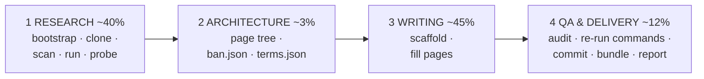

# github-wiki-llm-writer

<!-- md-i18n:switcher -->
**अन्य भाषाओं में:** [English](README.md) · [Deutsch](README.de.md) · [中文](README.zh.md) · हिन्दी · [Español](README.es.md) · [Русский](README.ru.md)

किसी रिपॉज़िटरी URL को एक पूरा, **तथ्यों से सत्यापित** GitHub Wiki बना दें — LLM एजेंटों के लिए
बनाया गया, इंसानों के लिए भी उपयोगी।

यह किट एक ही अवलोकन से अस्तित्व में आया: "इस रेपो के लिए wiki लिखो" कहने पर एजेंट बड़े मन से
प्रोजेक्ट की अपनी README उतार देता है — और README अक्सर गलत होती है। जिस रन से यह किट निकाला गया,
उसमें विषय ने *सिंटैक्स हाइलाइटिंग* का दावा किया (पूरे रिपॉज़िटरी में कोई हाइलाइटर मौजूद ही नहीं
था) और *नेस्टेड सूचियों* का (वे सादे टेक्स्ट की तरह रेंडर हो रही थीं)। दोनों दावे विश्वसनीय थे,
दोनों कॉपी करना आसान था, और दोनों असत्य के रूप में ही डिलीवर होते — जिन्हें पाठक दो मिनट में
झूठा साबित कर सकता है।

इसलिए पूरा किट एक ही नियम के इर्द-गिर्द गठित है:

> **कोई दावा wiki में तभी आता है जब वह किसी स्रोत-पंक्ति तक traced हो, या सॉफ़्टवेयर चलाकर
> दोबारा पैदा किया गया हो।**

कोड पढ़ना बताता है कि सॉफ़्टवेयर *क्या करना चाहता है*। उसे चलाना बताता है कि वह *क्या करता है*।
दोनों के बीच का फ़ासला ही वह जगह है जहाँ हर दिलचस्प खोज रहती है।

---

## यह क्या पैदा करता है

संदर्भ रन से — [paulmann/MD.Viewer](https://github.com/paulmann/MD.Viewer), एक self-hosted PHP
Markdown व्यूअर:

| | |
|---|---|
| पृष्ठ | 20 सामग्री पृष्ठ + `_Sidebar.md` + `_Footer.md` |
| शब्द | 73 013 |
| GitHub Alerts | 154 (`NOTE` / `TIP` / `IMPORTANT` / `WARNING` / `CAUTION`) |
| Mermaid आरेख | 27 |
| तालिका पंक्तियाँ | 1 687 |
| आंतरिक wiki-लिंक | 341, सभी रिज़ॉल्व होते हैं |
| QA त्रुटियाँ | **0** |
| `bash -n` पास करने वाले shell ब्लॉक | 137 |

पृष्ठ समुच्चय: Home · Getting Started · Features and Live Demo · Comparison with Alternatives ·
Installation and Deployment · Configuration Reference · Settings Panel · Markdown Extensions
Matrix · Authoring Guide · File Browser and Routing · Self-Updater Guide · Machine API · File
Upload and Clipboard · Security Hardening Guide · Performance and Caching · Architecture ·
Troubleshooting · FAQ · Changelog and Versioning · Glossary।

नमूना आर्टिफ़ैक्ट [`examples/`](examples/) में हैं।

---

## त्वरित शुरुआत

```bash
git clone https://github.com/paulmann/github-wiki-llm-writer.git
cd github-wiki-llm-writer

# 1. environment (idempotent; prints a capability + egress report)
bash setup/bootstrap.sh

# 2. inventory the subject
git clone <REPO_URL> /tmp/subject
python3 scan/repo_scan.py /tmp/subject --brief -o research/scan.json

# 3. RUN it and probe it
python3 probe/webapp_probe.py --repo /tmp/subject \
        --entry / --suite generic -o research/probe.json --md research/probe.md

# 4. scaffold the wiki
python3 scaffold/new_page.py wiki/OWNER.REPO.wiki --init \
        --project SUBJECT --repo-url <REPO_URL> \
        --pages "Home,Getting Started,Configuration Reference,Architecture,Troubleshooting,FAQ,Glossary"

# 5. write the pages, then audit
python3 qa/qa_wiki.py --self-test
python3 qa/qa_wiki.py wiki/OWNER.REPO.wiki --strict

# 6. deliver
bash publish/publish.sh wiki/OWNER.REPO.wiki OWNER/REPO
```

एजेंट के लिए प्रवेश-बिंदु [`SKILL.md`](SKILL.md) है। जो इंसान किसी एजेंट को चला रहा है, उसके लिए
यह [`PROMPT.md`](PROMPT.md) है — चिपकाने के लिए तैयार कार्य-प्रॉम्प्ट, जिसमें सिर्फ़ रिपॉज़िटरी
URL बदलता है।

---

## चार चरण



| चरण | उपकरण | आउटपुट |
|---|---|---|
| 1 शोध | `setup/bootstrap.sh`, `scan/repo_scan.py`, `lib/serve.py`, `probe/webapp_probe.py` | `research/{summary,architecture,domain-notes}.md`, `facts.json`, `sources.md` |
| 2 आर्किटेक्चर | `templates/*` | `PROGRESS.json` में पेज ट्री, `ban.json`, `terms.json` |
| 3 लेखन | `scaffold/new_page.py` | wiki पृष्ठ |
| 4 QA + डिलीवरी | `qa/qa_wiki.py`, `publish/publish.sh` | 0-त्रुटि वाला ऑडिट, कमिट, सत्यापित बंडल, `REPORT.md` |

| [`qa/fix_toc.py`](qa/fix_toc.py) | 3 | GitHub slugs के साथ पृष्ठ का `## Contents` फिर से बनाएँ — block-scoped, `--bak`, शब्द-गणना गार्ड, `--self-test` उस दुर्घटना को दोबारा पैदा करता है जिसने एक पृष्ठ खा लिया |
| [`lib/session.py`](lib/session.py) | 1 | `SessionClient` (cookie jar, कोई स्वतः रीडायरेक्ट नहीं) + `csrf_from_html` — ऐसी stateful और admin सतहों की जाँच करता है जहाँ `req.py` नहीं पहुँच सकता |
| [`qa/verify_commands.py`](qa/verify_commands.py) | 4 | एक पूरा किया गया चरण-4 harness: ताज़ा क्लोन, फिर हर दस्तावेज़ीकृत कमांड, साक्ष्य JSON के साथ |
| [`lib/evidence.py`](lib/evidence.py) | 1,4 | `write_evidence()` जाँच-साक्ष्य खोने के बजाय वैकल्पिक डायरेक्टरी में दोबारा कोशिश करता है (PITFALLS B11) |
| [`setup/check_runtime.py`](setup/check_runtime.py) | 1 | विषय के घोषित न्यूनतम रनटाइम की तुलना स्थापित संस्करण से; अंतर पर exit 2 |
| [`examples/run2-mdscribe/`](examples/run2-mdscribe/) | — | दूसरा संदर्भ रन: 1571-पंक्ति की बैटरी, दो लेआउट, stateful admin प्रवाह |
| [`setup/snapshot.sh`](setup/snapshot.sh) | सभी | चरण-सीमाओं पर कार्यक्षेत्र का git-स्नैपशॉट, ताकि एक खराब बल्क-एडिट घंटों की नहीं, मिनटों की क़ीमत ले |
| [`templates/REWORK-STATE.md.tmpl`](templates/REWORK-STATE.md.tmpl) | सभी | रिकवरी फ़ाइल: कैसे फिर शुरू करें, पर्यावरण कैसे दोबारा बनाएँ, विचित्रताएँ, केवल-संलग्न लॉग |
पूरा विवरण [`AGENTS.md`](AGENTS.md) में।

---

## उपकरण

Python 3.8+ और `bash` के अतिरिक्त कोई निर्भरता नहीं।

| उपकरण | यह क्या करता है |
|---|---|
| [`setup/bootstrap.sh`](setup/bootstrap.sh) | `apt-get update` (वह क़दम जो सब भूल जाते हैं), git/curl/jq/php स्थापित करता है, क्षमताएँ और नेटवर्क एग्रेस छापता है |
| [`setup/PITFALLS.md`](setup/PITFALLS.md) | 31 जाल, बर्बाद हुए समय के क्रम में। कोई भी प्रोब लिखने से पहले पढ़ें |
| [`scan/repo_scan.py`](scan/repo_scan.py) | पूरे रेपो की सूची → JSON + दो मिनट की संक्षिप्त रिपोर्ट |
| [`lib/req.py`](lib/req.py) | मानक लाइब्रेरी का HTTP क्लाइंट जो `(status, headers, body)` **हर** नतीजे के लिए देता है, 4xx/5xx सहित |
| [`lib/serve.py`](lib/serve.py) | `ServedApp`: सत्यापित-मुक्त पोर्ट पर साफ़ कॉपी रखता है और अपना प्रोसेस ग्रुप ख़त्म करता है |
| [`probe/webapp_probe.py`](probe/webapp_probe.py) | घोषणात्मक बैटरी → साक्ष्य JSON + Markdown |
| [`scaffold/new_page.py`](scaffold/new_page.py) | wiki का ढाँचा या एकल पृष्ठ, बनावट से ही QA-साफ़ |
| [`qa/qa_wiki.py`](qa/qa_wiki.py) | पूरा ऑडिट, `--self-test` के साथ |
| [`publish/publish.sh`](publish/publish.sh) | QA गेट → क्लोन → कमिट → सत्यापित बंडल → निर्देश |
| [`PUBLISHING.md`](PUBLISHING.md) | सत्यापित प्रकाशन प्रवाह: असंबंधित इतिहास का merge, `.gitignore` के जाल, मालिक की पहचान से कमिट |

### `scan/repo_scan.py`

भाषा के प्रति सजग, पर कभी भाषा-निर्भर नहीं: PHP, JS/TS, Python, Go, Ruby, Java, C#, PowerShell
और shell के लिए सिंबल निष्कर्षण; आठ इकोसिस्टम के लिए manifest की पहचान। संदर्भ रन में इसने एक
ही पास में सामने लाया: **शून्य टैग और शून्य रिलीज़** (जो बदल देता है कि वर्ज़निंग को कैसे
दस्तावेज़ करना है), **एक अतिरिक्त एट्रिब्यूशन क्लॉज़ वाला** MIT लाइसेंस, **बिल्कुल भी
निर्भरता-मैनिफ़ेस्ट नहीं**, ग्यारह प्रति-फ़ाइल वर्ज़न मार्कर, तीन बाहरी CDN होस्ट, और अठारह
`raw-html-passthrough` सिग्नल हिट — अंतिम ने सीधे सबसे महत्वपूर्ण सुरक्षा-खोज की ओर इशारा किया।

### `probe/webapp_probe.py`

बीस पाथ-ट्रैवर्सल पेलोड, छब्बीस इंजेक्शन पेलोड, कॉन्फ़िग-फ़्लैग गेटिंग, अपलोड फ़ाइलनाम मैट्रिस,
API स्टेटस कोड, रिस्पॉन्स-हेडर की सूची, और डिस्क पर साइड-इफ़ेक्ट। इसने मैनुअल सत्र की हर खोज
**0.4 सेकंड** में दोबारा पैदा की और उससे अधिक पाया: 26 में से 19 इंजेक्शन पेलोड जस के तस बच गए,
जबकि हाथ से 9 मिले थे।

सूट केवल ऐसे फ़ंक्शन हैं जो `probe.run(...)` / `probe.battery_*(...)` कहते हैं, इसलिए नए विषय के
लिए एक जोड़ना कुछ पंक्तियों का काम है। बैटरियाँ ख़ुद ट्रांसपोर्ट-स्तर पर हैं और हर उस चीज़ पर
चलती हैं जिसका URL है।

### `qa/qa_wiki.py`

एक कमांड जाँचता है: wiki-लिंक के लक्ष्य और एंकर · पृष्ठ के भीतर के एंकर (GitHub के सटीक slug
एल्गोरिदम से गणना — इन्हें कभी हाथ से न लिखें) · साइडबार और फ़ुटर का कवरेज · प्रति पृष्ठ एक
H1 · प्रारंभिक अनुच्छेद · `## See also` · alert प्रकार · कोड-फ़ेंस की नेस्टिंग · गद्य में रिसता
`[[...]]` · Mermaid के ब्रैकेट, उद्धरण, नंगा `&` और लेबल की कोटिंग · हर shell ब्लॉक पर
`bash -n` · हर Python ब्लॉक पर `compile()` · मार्केटिंग भराव · सजावटी emoji · प्रतिबंधित दावे ·
शब्दावली की एकरूपता।

इसने संदर्भ wiki में एक असली शिपिंग बग पकड़ा: एक ```` ```markdown ```` उदाहरण जिसमें ```` ```bash ```` फ़ेंस था, जिसने बाहरी ब्लॉक जल्दी बंद कर दिया और पृष्ठ का बाक़ी हिस्सा कचरा बनकर रेंडर होता।

> [!IMPORTANT]
> **हर सत्र में एक बार `--self-test` चलाएँ।** इस चेकर के पहले संस्करण ने 381 लिंक त्रुटियाँ
> बताईं — सब झूठी। दूसरे ने 12 एंकर त्रुटियाँ बताईं — 11 झूठी। तीसरे बग ने हर पृष्ठ को *पिछले*
> पृष्ठ के टेक्स्ट के विरुद्ध जाँचा और 235 भूतिया त्रुटियाँ पैदा कीं। जो चेकर विफल ही नहीं हो सकता
> वह बिना चेकर से बुरा है, क्योंकि तब साफ़ रन का कोई अर्थ नहीं रहता। `--self-test` उसे
> जान-बूझकर तोड़ी गई फ़िक्स्चर खिलाता है और नौ विशिष्ट पकड़ों की माँग करता है।

---

## `serve.py` क्यों मौजूद है

वेब ऐप जाँचने का सबसे सीधा तरीक़ा:

```bash
cd /tmp/app && php -S 127.0.0.1:8080 &   # "Address already in use" → dies silently
curl http://127.0.0.1:8080/md.php        # ← talks to the OLD server
```

पुराने सर्वर के पास पुराना document root और पुरानी स्टेट फ़ाइलें हैं। आप नतीजा निकालते हैं कि
कोई कॉन्फ़िग फ़ाइल "नहीं बनी", या कोई फ़्लैग "असर में नहीं आया" — दोनों गलत। यह सचमुच हुआ और एक
पूरा डीबग चक्र खा गया।

`ServedApp` सत्यापित-मुक्त पोर्ट चुनता है, टेम्प डायरेक्टरी में **साफ़ कॉपी** रखता है, सॉकेट की
प्रतीक्षा करता है, एक HTTP प्रोब भेजकर पुष्टि करता है कि इंटरप्रेटर हर अनुरोध पर मर नहीं रहा, और
बाहर निकलते समय अपना प्रोसेस ग्रुप मार देता है:

```python
from serve import ServedApp
with ServedApp('repo/SUBJECT', copy=['md.php', 'css', 'js']) as app:
    app.write('md.md', '# Hi\n')
    r = app.get('/md.php')
    print(r.status, r.header('Content-Type'))
    app.set_ini({'DISABLE_UPLOAD': 'false'})   # flip a flag, re-test
    print(app.ls())                            # what did the app write?
```

---

## उपकरणों में सन्निहित GitHub Wiki की बारीकियाँ

ये चीज़ें गलत करना आसान और देर से पता चलने पर महँगी हैं:

| तथ्य | कहाँ सन्निहित |
|---|---|
| wiki फ़ाइलनामों में **स्पेस** होते हैं; GitHub उन्हें हाइफ़न वाले URL में मैप करता है और उसी के विरुद्ध `[[Page Name]]` रिज़ॉल्व करता है | `scaffold/`, `qa/`, `publish/` की प्री-फ़्लाइट |
| wiki रेपो की डिफ़ॉल्ट ब्रांच **`master`** है, `main` नहीं | `publish/publish.sh` |
| wiki रेपो पहले से मौजूद हो सकता है, एक placeholder `Home.md` के साथ — कभी force-push न करें | `publish/publish.sh` |
| गद्य में `[[1,2]]` एक ऐसे पृष्ठ का जीवित लिंक बन जाता है जो मौजूद नहीं | `qa/qa_wiki.py` की गद्य-जाँच |
| एंकर GitHub के slug एल्गोरिदम का पालन करते हैं, जिसमें न-सिकुड़े दोहरे हाइफ़न भी शामिल हैं (`#step-6--read-mdini`) | `qa/qa_wiki.py` |
| Mermaid को `&amp;`, कोटेड लेबल, और प्रकार-सजग `end` संतुलन चाहिए | `qa/qa_wiki.py` |
| 3-बैकटिक वाला उदाहरण जिसमें 3-बैकटिक फ़ेंस हो, चुपचाप जल्दी बंद हो जाता है | `qa/qa_wiki.py` की फ़ेंस-जाँच |
| सैंडबॉक्स में नियंत्रक टर्मिनल नहीं होता, इसलिए `git push` और इंटरैक्टिव प्रॉम्प्ट विफल होते हैं | `publish/publish.sh` (बंडल + निर्देश, कभी प्रॉम्प्ट नहीं) |

---

## केवल PHP का उपकरण नहीं

`ServedApp` को बस एक कमांड टेम्पलेट चाहिए:

```bash
python3 lib/serve.py repo/SUBJECT --serve-cmd 'node {root}/server.js'
python3 lib/serve.py repo/SUBJECT --serve-cmd 'python3 -m http.server {port} -d {root}'
```

यदि विषय सर्वर नहीं बल्कि CLI है, तो `serve.py` छोड़ें और ऐसा सूट लिखें जो बाहर कमांड चलाए और
stdout/stderr/exit कोड पकड़े। क़ीमती हिस्सा *आकार* है — घोषणात्मक केस → साक्ष्य JSON → Markdown
तालिका — ट्रांसपोर्ट नहीं।

---

## रखरखाव टिप्पणी

इन उपकरणों को एक असली 22-पृष्ठ डिलीवरेबल के विरुद्ध डीबग किया गया, और इन्हें किट में निकालने से
नौ और बग सामने आए (सभी [`CHANGELOG.md`](CHANGELOG.md) में सूचीबद्ध)। यदि आप किसी रन के दौरान
इनमें से एक को सुधारें — और आप सुधारेंगे, क्योंकि हर नया विषय एक नया किनारा सामने लाता है — तो
**सुधार वापस कमिट करें।** टूलकिट डिलीवरी का हिस्सा है, फेंकने योग्य scaffold नहीं।

## लाइसेंस

PolyForm Noncommercial 1.0.0 — देखें [LICENSE](LICENSE)।

## यह भी देखें

- [`SKILL.md`](SKILL.md) — एजेंट का प्रवेश-बिंदु
- [`AGENTS.md`](AGENTS.md) — चरण-दर-चरण उपकरण मैपिंग
- [`PROMPT.md`](PROMPT.md) — एजेंट को देने वाला कार्य-प्रॉम्प्ट
- [`setup/PITFALLS.md`](setup/PITFALLS.md) — कोई भी प्रोब लिखने से पहले पढ़ें
- [`examples/`](examples/) — संदर्भ रन के आर्टिफ़ैक्ट
