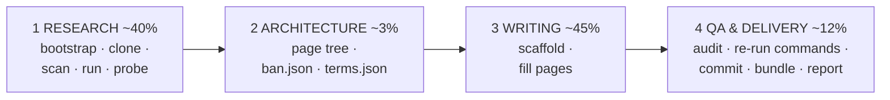

# github-wiki-llm-writer

<!-- md-i18n:switcher -->
**Read this in:** English · [Deutsch](README.de.md) · [中文](README.zh.md) · [हिन्दी](README.hi.md) · [Español](README.es.md) · [Русский](README.ru.md)

Turn a repository URL into a complete, **fact-verified** GitHub Wiki — built for
LLM agents, usable by humans.

The kit exists because of one observation: an agent asked to "write a wiki for
this repo" will happily transcribe the project's own README, and READMEs are
wrong. In the run this was extracted from, the subject claimed *syntax
highlighting* (no highlighter existed anywhere in the repository) and *nested
lists* (they rendered as literal text). Both claims were plausible, both were
easy to copy, and both would have shipped as falsehoods a reader could disprove
in two minutes.

So the whole kit is organised around one rule:

> **A claim enters the wiki only if it is traced to a source line, or reproduced
> by running the software.**

Reading code tells you what software *intends*. Running it tells you what it
*does*. The gap is where every interesting finding lives.

---

## What it produces

From the reference run — [paulmann/MD.Viewer](https://github.com/paulmann/MD.Viewer),
a self-hosted PHP Markdown viewer:

| | |
|---|---|
| Pages | 20 content pages + `_Sidebar.md` + `_Footer.md` |
| Words | 73 013 |
| GitHub Alerts | 154 (`NOTE` / `TIP` / `IMPORTANT` / `WARNING` / `CAUTION`) |
| Mermaid diagrams | 27 |
| Table rows | 1 687 |
| Internal wiki-links | 341, all resolving |
| QA errors | **0** |
| Shell blocks passing `bash -n` | 137 |

Page set: Home · Getting Started · Features and Live Demo · Comparison with
Alternatives · Installation and Deployment · Configuration Reference · Settings
Panel · Markdown Extensions Matrix · Authoring Guide · File Browser and Routing ·
Self-Updater Guide · Machine API · File Upload and Clipboard · Security Hardening
Guide · Performance and Caching · Architecture · Troubleshooting · FAQ ·
Changelog and Versioning · Glossary.

Sample artefacts are in [`examples/`](examples/).

---

## Quickstart

```bash
git clone https://github.com/paulmann/github-wiki-llm-writer.git
cd github-wiki-llm-writer

# 1. environment (idempotent; prints a capability + egress report)
bash setup/bootstrap.sh

# 2. inventory the subject
git clone <REPO_URL> /tmp/subject
python3 scan/repo_scan.py /tmp/subject --brief -o research/scan.json

# 3. RUN it and probe it
python3 probe/webapp_probe.py --repo /tmp/subject \
        --entry / --suite generic -o research/probe.json --md research/probe.md

# 4. scaffold the wiki
python3 scaffold/new_page.py wiki/OWNER.REPO.wiki --init \
        --project SUBJECT --repo-url <REPO_URL> \
        --pages "Home,Getting Started,Configuration Reference,Architecture,Troubleshooting,FAQ,Glossary"

# 5. write the pages, then audit
python3 qa/qa_wiki.py --self-test
python3 qa/qa_wiki.py wiki/OWNER.REPO.wiki --strict

# 6. deliver
bash publish/publish.sh wiki/OWNER.REPO.wiki OWNER/REPO
```

For an agent, the entry point is [`SKILL.md`](SKILL.md). For a human driving an
agent, it is [`PROMPT.md`](PROMPT.md) — a ready-to-paste task prompt in which
only the repository URL changes.

---

## The four phases



| Phase | Tool | Output |
|---|---|---|
| 1 Research | `setup/bootstrap.sh`, `scan/repo_scan.py`, `lib/serve.py`, `probe/webapp_probe.py` | `research/{summary,architecture,domain-notes}.md`, `facts.json`, `sources.md` |
| 2 Architecture | `templates/*` | page tree in `PROGRESS.json`, `ban.json`, `terms.json` |
| 3 Writing | `scaffold/new_page.py` | the wiki pages |
| 4 QA + delivery | `qa/qa_wiki.py`, `publish/publish.sh` | 0-error audit, commit, verified bundle, `REPORT.md` |

| [`qa/fix_toc.py`](qa/fix_toc.py) | 3 | Rebuild a page's `## Contents` with GitHub slugs — block-scoped, `--bak`, word-count guard, `--self-test` reproducing the accident that ate a page |
| [`lib/session.py`](lib/session.py) | 1 | `SessionClient` (cookie jar, no auto-redirect) + `csrf_from_html` — probes stateful/admin surfaces that `req.py` cannot |
| [`qa/verify_commands.py`](qa/verify_commands.py) | 4 | Worked Phase-4 harness: fresh clone, then every documented command, with evidence JSON |
| [`lib/evidence.py`](lib/evidence.py) | 1,4 | `write_evidence()` retries into a fallback dir instead of losing probe evidence (PITFALLS B11) |
| [`setup/check_runtime.py`](setup/check_runtime.py) | 1 | Subject's declared runtime floor vs installed; exit 2 on mismatch |
| [`examples/run2-mdscribe/`](examples/run2-mdscribe/) | — | Second reference run: 1571-line battery, two layouts, stateful admin flow |
| [`setup/snapshot.sh`](setup/snapshot.sh) | all | Git-snapshot the workspace at phase boundaries, so a bad bulk edit costs minutes not hours |
| [`templates/REWORK-STATE.md.tmpl`](templates/REWORK-STATE.md.tmpl) | all | Recovery file: how to resume, environment rebuild, quirks, append-only log |
Full detail in [`AGENTS.md`](AGENTS.md).

---

## Tools

No dependencies beyond Python 3.8+ and `bash`.

| Tool | What it does |
|---|---|
| [`setup/bootstrap.sh`](setup/bootstrap.sh) | `apt-get update` (the step everyone forgets), installs git/curl/jq/php, prints capabilities and network egress |
| [`setup/PITFALLS.md`](setup/PITFALLS.md) | 31 traps, ordered by time wasted. Read before writing any probe |
| [`scan/repo_scan.py`](scan/repo_scan.py) | Whole-repo inventory → JSON + a two-minute brief |
| [`lib/req.py`](lib/req.py) | stdlib HTTP client returning `(status, headers, body)` for **every** outcome including 4xx/5xx |
| [`lib/serve.py`](lib/serve.py) | `ServedApp`: stages a clean copy on a **verified-free** port and kills its own process group |
| [`probe/webapp_probe.py`](probe/webapp_probe.py) | Declarative batteries → evidence JSON + Markdown |
| [`scaffold/new_page.py`](scaffold/new_page.py) | Wiki skeleton or single page, QA-clean by construction |
| [`qa/qa_wiki.py`](qa/qa_wiki.py) | The full audit, with `--self-test` |
| [`publish/publish.sh`](publish/publish.sh) | QA gate → clone → commit → verified bundle → instructions |
| [`PUBLISHING.md`](PUBLISHING.md) | Verified publishing flow: unrelated-histories merge, `.gitignore` traps, owner-identity commits |

### `scan/repo_scan.py`

Language-aware but never language-dependent: symbol extraction for PHP, JS/TS,
Python, Go, Ruby, Java, C#, PowerShell and shell; manifest detection for eight
ecosystems. In the reference run it surfaced, in one pass: **zero tags and zero
releases** (which changes how versioning must be documented), an MIT license
**with an extra attribution clause**, **no dependency manifest at all**, eleven
per-file version markers, three external CDN hosts, and eighteen
`raw-html-passthrough` signal hits — the last pointing straight at the main
security finding.

### `probe/webapp_probe.py`

Twenty path-traversal payloads, twenty-six injection payloads, config-flag
gating, upload filename matrices, API status codes, response-header inventory,
and disk side-effects. It reproduced every finding from the manual session in
**0.4 seconds** and found more: 19 of 26 injection payloads survived verbatim,
versus the 9 found by hand.

Suites are just functions that call `probe.run(...)` / `probe.battery_*(...)`, so
adding one for a new subject is a few lines. The batteries themselves are
transport-level and work against anything with a URL.

### `qa/qa_wiki.py`

One command checks: wiki-link targets and anchors · in-page anchors (computed
with GitHub's exact slug algorithm — never hand-write these) · sidebar/footer
coverage · one-H1-per-page · lead paragraph · `## See also` · alert types ·
code-fence nesting · `[[...]]` leaking into prose · mermaid brackets, quotes,
bare `&` and label quoting · `bash -n` on every shell block · `compile()` on
every Python block · marketing filler · decorative emoji · banned claims ·
terminology consistency.

It caught a genuine shipping bug in the reference wiki: a ```` ```markdown ````
example containing a ```` ```bash ```` fence, which closed the outer block early
and would have rendered the rest of the page as garbage.

> [!IMPORTANT]
> **Run `--self-test` once per session.** The first version of this checker
> reported 381 link errors — all false. The second reported 12 anchor errors —
> 11 false. A third bug audited every page against the *previous* page's text and
> produced 235 phantom errors. A checker that cannot fail is worse than no
> checker, because a clean run then means nothing. `--self-test` feeds it a
> deliberately broken fixture and requires nine specific detections.

---

## Why `serve.py` exists

The obvious way to test a web app:

```bash
cd /tmp/app && php -S 127.0.0.1:8080 &   # "Address already in use" → dies silently
curl http://127.0.0.1:8080/md.php        # ← talks to the OLD server
```

The old server has the old document root and old state files. You conclude that a
config file "was not created", or that a flag "did not take effect" — both false.
This happened for real and cost a full debug cycle.

`ServedApp` picks a verified-free port, stages a **clean copy** in a temp dir,
waits for the socket, issues one HTTP probe to confirm the interpreter is not
dying on every request, and kills its own process group on exit:

```python
from serve import ServedApp
with ServedApp('repo/SUBJECT', copy=['md.php', 'css', 'js']) as app:
    app.write('md.md', '# Hi\n')
    r = app.get('/md.php')
    print(r.status, r.header('Content-Type'))
    app.set_ini({'DISABLE_UPLOAD': 'false'})   # flip a flag, re-test
    print(app.ls())                            # what did the app write?
```

---

## GitHub Wiki specifics encoded in the tools

Things that are easy to get wrong and expensive to discover late:

| Fact | Encoded in |
|---|---|
| Wiki filenames use **spaces**; GitHub maps them to hyphenated URLs and resolves `[[Page Name]]` against that | `scaffold/`, `qa/`, `publish/` pre-flight |
| The wiki repo's default branch is **`master`**, not `main` | `publish/publish.sh` |
| A wiki repo may already exist with a placeholder `Home.md` — never force-push | `publish/publish.sh` |
| `[[1,2]]` in prose becomes a live link to a non-existent page | `qa/qa_wiki.py` prose check |
| Anchors follow GitHub's slug algorithm, including non-collapsed double hyphens (`#step-6--read-mdini`) | `qa/qa_wiki.py` |
| Mermaid needs `&amp;`, quoted labels, and kind-aware `end` balancing | `qa/qa_wiki.py` |
| A 3-backtick example containing a 3-backtick fence silently closes early | `qa/qa_wiki.py` fence check |
| Sandboxes have no controlling terminal, so `git push` and interactive prompts fail | `publish/publish.sh` (bundle + instructions, never prompts) |

---

## Not a PHP-only tool

`ServedApp` just needs a command template:

```bash
python3 lib/serve.py repo/SUBJECT --serve-cmd 'node {root}/server.js'
python3 lib/serve.py repo/SUBJECT --serve-cmd 'python3 -m http.server {port} -d {root}'
```

For a CLI subject rather than a server, skip `serve.py` and write a suite that
shells out and captures stdout/stderr/exit codes. The valuable part is the
*shape* — declarative cases → evidence JSON → Markdown table — not the transport.

---

## Maintenance note

These tools were debugged against a real 22-page deliverable, and extracting them
into a kit surfaced nine further bugs (all listed in [`CHANGELOG.md`](CHANGELOG.md)).
If you improve one during a run — and you probably will, since each new subject
surfaces a new edge case — **commit the improvement back.** The toolkit is part of
the delivery, not scaffolding to be thrown away.

## License

PolyForm Noncommercial 1.0.0 — see [LICENSE](LICENSE).

## See also

- [`SKILL.md`](SKILL.md) — the agent entry point
- [`AGENTS.md`](AGENTS.md) — phase-by-phase tool mapping
- [`PROMPT.md`](PROMPT.md) — the task prompt to hand an agent
- [`setup/PITFALLS.md`](setup/PITFALLS.md) — read before writing any probe
- [`examples/`](examples/) — artefacts from the reference run
