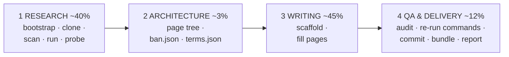

# github-wiki-llm-writer

<!-- md-i18n:switcher -->
**На других языках:** [English](README.md) · [Deutsch](README.de.md) · [中文](README.zh.md) · [हिन्दी](README.hi.md) · [Español](README.es.md) · Русский

Превращает URL репозитория в полную, **проверенную по фактам** GitHub Wiki — сделано для
LLM-агентов, пригодно для людей.

Набор появился из одного наблюдения: агент, которого просят «написать вики для этого репозитория»,
охотно пересказывает README самого проекта, а README ошибаются. В том прогоне, из которого это
извлечено, объект заявлял о *подсветке синтаксиса* (никакого подсветчика во всём репозитории не
было) и о *вложенных списках* (они выводились буквальным текстом). Оба утверждения были
правдоподобны, оба легко копировались, и оба ушли бы в поставку как ложь, которую читатель
опровергает за две минуты.

Поэтому весь набор построен вокруг одного правила:

> **Утверждение попадает в вики только если оно прослежено до строки исходника или воспроизведено
> запуском программы.**

Чтение кода говорит, что программа *замышляет*. Запуск говорит, что она *делает*. Разрыв между
этим — место, где живёт любая интересная находка.

---

## Что он даёт

Из эталонного прогона — [paulmann/MD.Viewer](https://github.com/paulmann/MD.Viewer), самостоятельно
размещённый просмотрщик Markdown на PHP:

| | |
|---|---|
| Страницы | 20 содержательных страниц + `_Sidebar.md` + `_Footer.md` |
| Слов | 73 013 |
| GitHub Alerts | 154 (`NOTE` / `TIP` / `IMPORTANT` / `WARNING` / `CAUTION`) |
| Диаграмм Mermaid | 27 |
| Строк таблиц | 1 687 |
| Внутренних вики-ссылок | 341, все разрешаются |
| Ошибок QA | **0** |
| Блоков shell, проходящих `bash -n` | 137 |

Набор страниц: Home · Getting Started · Features and Live Demo · Comparison with Alternatives ·
Installation and Deployment · Configuration Reference · Settings Panel · Markdown Extensions
Matrix · Authoring Guide · File Browser and Routing · Self-Updater Guide · Machine API · File
Upload and Clipboard · Security Hardening Guide · Performance and Caching · Architecture ·
Troubleshooting · FAQ · Changelog and Versioning · Glossary.

Образцы артефактов — в [`examples/`](examples/).

---

## Быстрый старт

```bash
git clone https://github.com/paulmann/github-wiki-llm-writer.git
cd github-wiki-llm-writer

# 1. environment (idempotent; prints a capability + egress report)
bash setup/bootstrap.sh

# 2. inventory the subject
git clone <REPO_URL> /tmp/subject
python3 scan/repo_scan.py /tmp/subject --brief -o research/scan.json

# 3. RUN it and probe it
python3 probe/webapp_probe.py --repo /tmp/subject \
        --entry / --suite generic -o research/probe.json --md research/probe.md

# 4. scaffold the wiki
python3 scaffold/new_page.py wiki/OWNER.REPO.wiki --init \
        --project SUBJECT --repo-url <REPO_URL> \
        --pages "Home,Getting Started,Configuration Reference,Architecture,Troubleshooting,FAQ,Glossary"

# 5. write the pages, then audit
python3 qa/qa_wiki.py --self-test
python3 qa/qa_wiki.py wiki/OWNER.REPO.wiki --strict

# 6. deliver
bash publish/publish.sh wiki/OWNER.REPO.wiki OWNER/REPO
```

Для агента вход — [`SKILL.md`](SKILL.md). Для человека, который ведёт агента, — [`PROMPT.md`](PROMPT.md):
готовый к вставке промпт задачи, в котором меняется только URL репозитория.

---

## Четыре фазы



| Фаза | Инструмент | Результат |
|---|---|---|
| 1 Исследование | `setup/bootstrap.sh`, `scan/repo_scan.py`, `lib/serve.py`, `probe/webapp_probe.py` | `research/{summary,architecture,domain-notes}.md`, `facts.json`, `sources.md` |
| 2 Архитектура | `templates/*` | дерево страниц в `PROGRESS.json`, `ban.json`, `terms.json` |
| 3 Написание | `scaffold/new_page.py` | сами страницы вики |
| 4 QA и поставка | `qa/qa_wiki.py`, `publish/publish.sh` | аудит с 0 ошибок, коммит, проверенный bundle, `REPORT.md` |

| [`qa/fix_toc.py`](qa/fix_toc.py) | 3 | Пересобрать `## Contents` страницы по слагам GitHub — с ограничением по блоку, `--bak`, защитой по числу слов, `--self-test`, воспроизводящим аварию, которая съела страницу |
| [`lib/session.py`](lib/session.py) | 1 | `SessionClient` (cookie jar, без авторедиректа) + `csrf_from_html` — проверяет состоянийные и админские поверхности, до которых не дотягивается `req.py` |
| [`qa/verify_commands.py`](qa/verify_commands.py) | 4 | Доведённая до конца оснастка фазы 4: свежий клон, затем каждая документированная команда, с JSON доказательств |
| [`lib/evidence.py`](lib/evidence.py) | 1,4 | `write_evidence()` повторяет попытку в запасном каталоге вместо потери доказательств проверки (PITFALLS B11) |
| [`setup/check_runtime.py`](setup/check_runtime.py) | 1 | Заявленный объектом минимум среды против установленного; код 2 при расхождении |
| [`examples/run2-mdscribe/`](examples/run2-mdscribe/) | — | Второй эталонный прогон: батарея на 1571 строку, две раскладки, состоянийный админский сценарий |
| [`setup/snapshot.sh`](setup/snapshot.sh) | все | git-снимок рабочего каталога на границах фаз, чтобы плохая массовая правка стоила минуты, а не часы |
| [`templates/REWORK-STATE.md.tmpl`](templates/REWORK-STATE.md.tmpl) | все | Файл восстановления: как продолжить, пересобрать окружение, особенности, журнал только на добавление |
Полные подробности — в [`AGENTS.md`](AGENTS.md).

---

## Инструменты

Никаких зависимостей, кроме Python 3.8+ и `bash`.

| Инструмент | Что он делает |
|---|---|
| [`setup/bootstrap.sh`](setup/bootstrap.sh) | `apt-get update` (шаг, который все забывают), ставит git/curl/jq/php, печатает возможности и сетевой выход |
| [`setup/PITFALLS.md`](setup/PITFALLS.md) | 31 ловушка, упорядоченная по потерянному времени. Читать до написания любой проверки |
| [`scan/repo_scan.py`](scan/repo_scan.py) | Опись всего репозитория → JSON + сводка на две минуты |
| [`lib/req.py`](lib/req.py) | HTTP-клиент стандартной библиотеки, возвращающий `(status, headers, body)` для **любого** исхода, включая 4xx/5xx |
| [`lib/serve.py`](lib/serve.py) | `ServedApp`: раскладывает чистую копию на **проверенно свободном** порту и убивает свою группу процессов |
| [`probe/webapp_probe.py`](probe/webapp_probe.py) | Декларативные батареи → JSON доказательств + Markdown |
| [`scaffold/new_page.py`](scaffold/new_page.py) | Скелет вики или отдельная страница, чистые по QA уже по построению |
| [`qa/qa_wiki.py`](qa/qa_wiki.py) | Полный аудит, с `--self-test` |
| [`publish/publish.sh`](publish/publish.sh) | Шлюз QA → клон → коммит → проверенный bundle → инструкции |
| [`PUBLISHING.md`](PUBLISHING.md) | Проверенный порядок публикации: слияние несвязанных историй, ловушки `.gitignore`, коммиты под идентичностью владельца |

### `scan/repo_scan.py`

Знает языки, но никогда от них не зависит: извлечение символов для PHP, JS/TS, Python, Go, Ruby,
Java, C#, PowerShell и shell; распознавание манифестов для восьми экосистем. В эталонном прогоне
он за один проход вытащил: **ноль тегов и ноль релизов** (это меняет то, как документировать
версионирование), лицензию MIT **с дополнительным пунктом об атрибуции**, **полное отсутствие
манифеста зависимостей**, одиннадцать пофайловых маркеров версии, три внешних CDN-хоста и
восемнадцать срабатываний сигнала `raw-html-passthrough` — последнее прямо указывало на главную
находку по безопасности.

### `probe/webapp_probe.py`

Двадцать полезных нагрузок обхода пути, двадцать шесть инъекционных, управление флагами
конфигурации, матрицы имён загружаемых файлов, коды состояния API, опись заголовков ответа и
побочные эффекты на диске. Он воспроизвёл все находки ручной сессии за **0,4 секунды** и нашёл
больше: 19 из 26 инъекционных нагрузок выжили в неизменном виде против 9, найденных руками.

Наборы — это просто функции, вызывающие `probe.run(...)` / `probe.battery_*(...)`, поэтому добавить
набор для нового объекта — несколько строк. Сами батареи работают на уровне транспорта и годятся
для всего, у чего есть URL.

### `qa/qa_wiki.py`

Одна команда проверяет: цели и якоря вики-ссылок · якоря внутри страницы (считаются точным
алгоритмом слагов GitHub — никогда не пишите их руками) · покрытие боковой панели и подвала · ровно
один H1 на страницу · вводный абзац · `## See also` · типы alert · вложенность блоков кода ·
`[[...]]`, протекающие в текст · скобки Mermaid, кавычки, голый `&` и квотирование подписей ·
`bash -n` на каждом блоке shell · `compile()` на каждом блоке Python · маркетинговый наполнитель ·
декоративные эмодзи · запрещённые утверждения · согласованность терминологии.

Он поймал настоящий дефект публикации в эталонной вики: пример ```` ```markdown ````, содержащий блок ```` ```bash ````, который закрывал внешний блок раньше времени и отрисовал бы остаток страницы мусором.

> [!IMPORTANT]
> **Запускайте `--self-test` раз за сессию.** Первая версия этой проверки сообщила о 381 ошибке
> ссылок — все ложные. Вторая сообщила о 12 ошибках якорей — 11 ложных. Третий дефект сверял
> каждую страницу с текстом *предыдущей* и дал 235 фантомных ошибок. Проверка, которая не умеет
> падать, хуже отсутствия проверки: тогда чистый прогон ничего не значит. `--self-test` подаёт ей
> заведомо сломанную фикстуру и требует девять конкретных обнаружений.

---

## Зачем нужен `serve.py`

Очевидный способ тестировать веб-приложение:

```bash
cd /tmp/app && php -S 127.0.0.1:8080 &   # "Address already in use" → dies silently
curl http://127.0.0.1:8080/md.php        # ← talks to the OLD server
```

У старого сервера старый document root и старые файлы состояния. Вы делаете вывод, что файл
конфигурации «не создался» или что флаг «не подействовал», — и то и другое неверно. Это случилось
на самом деле и стоило полного цикла отладки.

`ServedApp` выбирает проверенно свободный порт, раскладывает **чистую копию** во временном
каталоге, ждёт сокет, делает один HTTP-запрос, чтобы убедиться, что интерпретатор не умирает на
каждом запросе, и убивает свою группу процессов при выходе:

```python
from serve import ServedApp
with ServedApp('repo/SUBJECT', copy=['md.php', 'css', 'js']) as app:
    app.write('md.md', '# Hi\n')
    r = app.get('/md.php')
    print(r.status, r.header('Content-Type'))
    app.set_ini({'DISABLE_UPLOAD': 'false'})   # flip a flag, re-test
    print(app.ls())                            # what did the app write?
```

---

## Особенности GitHub Wiki, зашитые в инструменты

То, что легко сделать неправильно и дорого обнаружить поздно:

| Факт | Где зашито |
|---|---|
| Имена файлов вики используют **пробелы**; GitHub отображает их в URL с дефисами и разрешает `[[Page Name]]` относительно этого | предварительные проверки `scaffold/`, `qa/`, `publish/` |
| Ветка по умолчанию в репозитории вики — **`master`**, а не `main` | `publish/publish.sh` |
| Репозиторий вики может уже существовать с заглушкой `Home.md` — никогда не делайте force-push | `publish/publish.sh` |
| `[[1,2]]` в тексте становится живой ссылкой на несуществующую страницу | проверка текста в `qa/qa_wiki.py` |
| Якоря подчиняются алгоритму слагов GitHub, включая несхлопнутые двойные дефисы (`#step-6--read-mdini`) | `qa/qa_wiki.py` |
| Mermaid нужны `&amp;`, подписи в кавычках и балансировка `end` с учётом типа | `qa/qa_wiki.py` |
| Пример с 3 обратными кавычками, содержащий блок из 3 обратных кавычек, молча закрывается раньше времени | проверка блоков в `qa/qa_wiki.py` |
| В песочницах нет управляющего терминала, поэтому `git push` и интерактивные запросы падают | `publish/publish.sh` (bundle + инструкции, никогда запросы) |

---

## Не только для PHP

`ServedApp` нужен лишь шаблон команды:

```bash
python3 lib/serve.py repo/SUBJECT --serve-cmd 'node {root}/server.js'
python3 lib/serve.py repo/SUBJECT --serve-cmd 'python3 -m http.server {port} -d {root}'
```

Если объект — CLI, а не сервер, пропустите `serve.py` и напишите набор, который вызывает процессы и
снимает stdout/stderr/коды возврата. Ценна здесь *форма* — декларативные случаи → JSON
доказательств → таблица Markdown, — а не транспорт.

---

## Замечание о сопровождении

Эти инструменты отлаживались на реальной поставке из 22 страниц, и извлечение их в набор вскрыло
ещё девять дефектов (все перечислены в [`CHANGELOG.md`](CHANGELOG.md)). Если вы улучшите один из
них во время прогона — а вы, скорее всего, улучшите, потому что каждый новый объект вскрывает новый
край, — **закоммитьте улучшение обратно.** Набор инструментов — часть поставки, а не выбрасываемые
леса.

## Лицензия

PolyForm Noncommercial 1.0.0 — см. [LICENSE](LICENSE).

## См. также

- [`SKILL.md`](SKILL.md) — точка входа для агента
- [`AGENTS.md`](AGENTS.md) — соответствие инструментов фазам
- [`PROMPT.md`](PROMPT.md) — промпт задачи, который передают агенту
- [`setup/PITFALLS.md`](setup/PITFALLS.md) — прочитать до написания любой проверки
- [`examples/`](examples/) — артефакты эталонного прогона
