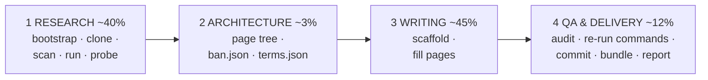

# github-wiki-llm-writer

<!-- md-i18n:switcher -->
**其他语言：** [English](README.md) · [Deutsch](README.de.md) · 中文 · [हिन्दी](README.hi.md) · [Español](README.es.md) · [Русский](README.ru.md)

把一个仓库 URL 变成一个完整、**经过事实核验**的 GitHub Wiki——为 LLM agent 而做，人也能用。

这套工具源于一个观察：让 agent「为这个仓库写一份 wiki」，它会欣然把项目自己的 README 抄一
遍，而 README 常常是错的。在提炼出这套工具的那次运行中，被考察的项目声称支持*语法高亮*
（整个仓库里根本不存在任何高亮器）和*嵌套列表*（它们被渲染成纯文本）。两条说法都可信，两条
都很容易照抄，而两条都会作为假话交付出去——读者两分钟就能推翻。

所以整套工具围绕一条规则组织：

> **一条说法只有在被追溯到某一行源码、或通过运行软件复现之后，才能进入 wiki。**

读代码告诉你软件*打算*做什么。运行它告诉你它*实际*做什么。两者之间的缺口，正是每一个有意思
的发现所在。

---

## 它产出什么

来自参考运行——[paulmann/MD.Viewer](https://github.com/paulmann/MD.Viewer)，一个自托管的
PHP Markdown 查看器：

| | |
|---|---|
| 页面 | 20 个内容页 + `_Sidebar.md` + `_Footer.md` |
| 字数 | 73 013 |
| GitHub Alerts | 154（`NOTE` / `TIP` / `IMPORTANT` / `WARNING` / `CAUTION`） |
| Mermaid 图 | 27 |
| 表格行 | 1 687 |
| 内部 wiki 链接 | 341，全部可解析 |
| QA 错误 | **0** |
| 通过 `bash -n` 的 shell 代码块 | 137 |

页面集合：Home · Getting Started · Features and Live Demo · Comparison with Alternatives ·
Installation and Deployment · Configuration Reference · Settings Panel · Markdown Extensions
Matrix · Authoring Guide · File Browser and Routing · Self-Updater Guide · Machine API · File
Upload and Clipboard · Security Hardening Guide · Performance and Caching · Architecture ·
Troubleshooting · FAQ · Changelog and Versioning · Glossary。

样例产物在 [`examples/`](examples/) 里。

---

## 快速开始

```bash
git clone https://github.com/paulmann/github-wiki-llm-writer.git
cd github-wiki-llm-writer

# 1. environment (idempotent; prints a capability + egress report)
bash setup/bootstrap.sh

# 2. inventory the subject
git clone <REPO_URL> /tmp/subject
python3 scan/repo_scan.py /tmp/subject --brief -o research/scan.json

# 3. RUN it and probe it
python3 probe/webapp_probe.py --repo /tmp/subject \
        --entry / --suite generic -o research/probe.json --md research/probe.md

# 4. scaffold the wiki
python3 scaffold/new_page.py wiki/OWNER.REPO.wiki --init \
        --project SUBJECT --repo-url <REPO_URL> \
        --pages "Home,Getting Started,Configuration Reference,Architecture,Troubleshooting,FAQ,Glossary"

# 5. write the pages, then audit
python3 qa/qa_wiki.py --self-test
python3 qa/qa_wiki.py wiki/OWNER.REPO.wiki --strict

# 6. deliver
bash publish/publish.sh wiki/OWNER.REPO.wiki OWNER/REPO
```

对 agent 来说，入口是 [`SKILL.md`](SKILL.md)。对驱动 agent 的人来说，入口是
[`PROMPT.md`](PROMPT.md)——一份可直接粘贴的任务提示，其中只有仓库 URL 需要改动。

---

## 四个阶段



| 阶段 | 工具 | 产出 |
|---|---|---|
| 1 调研 | `setup/bootstrap.sh`, `scan/repo_scan.py`, `lib/serve.py`, `probe/webapp_probe.py` | `research/{summary,architecture,domain-notes}.md`, `facts.json`, `sources.md` |
| 2 架构 | `templates/*` | `PROGRESS.json` 中的页面树、`ban.json`、`terms.json` |
| 3 写作 | `scaffold/new_page.py` | 那些 wiki 页面 |
| 4 QA 与交付 | `qa/qa_wiki.py`, `publish/publish.sh` | 零错误审计、提交、已核验的 bundle、`REPORT.md` |

| [`qa/fix_toc.py`](qa/fix_toc.py) | 3 | 用 GitHub slug 重建页面的 `## Contents`——块级隔离、`--bak`、字数守卫、`--self-test` 复现那起吃掉一页的事故 |
| [`lib/session.py`](lib/session.py) | 1 | `SessionClient`（cookie jar，不自动重定向）+ `csrf_from_html`——探测 `req.py` 无法触及的有状态/管理面 |
| [`qa/verify_commands.py`](qa/verify_commands.py) | 4 | 一个做通的第 4 阶段验证装置：全新克隆，然后跑每一条文档化命令，附证据 JSON |
| [`lib/evidence.py`](lib/evidence.py) | 1,4 | `write_evidence()` 退到备用目录重试，而不是丢掉探测证据（PITFALLS B11） |
| [`setup/check_runtime.py`](setup/check_runtime.py) | 1 | 比对被考察对象声明的运行时下限与已安装版本；不一致时退出码 2 |
| [`examples/run2-mdscribe/`](examples/run2-mdscribe/) | — | 第二次参考运行：1571 行的测试组、两套布局、有状态的管理流程 |
| [`setup/snapshot.sh`](setup/snapshot.sh) | 全部 | 在阶段边界给工作目录做 git 快照，让一次糟糕的批量编辑只花几分钟而不是几小时 |
| [`templates/REWORK-STATE.md.tmpl`](templates/REWORK-STATE.md.tmpl) | 全部 | 恢复文件：如何续做、重建环境、易错点、只追加的日志 |
完整细节见 [`AGENTS.md`](AGENTS.md)。

---

## 工具

除 Python 3.8+ 和 `bash` 之外没有依赖。

| 工具 | 它做什么 |
|---|---|
| [`setup/bootstrap.sh`](setup/bootstrap.sh) | `apt-get update`（人人都忘的那一步），安装 git/curl/jq/php，打印能力与网络出站情况 |
| [`setup/PITFALLS.md`](setup/PITFALLS.md) | 31 个陷阱，按浪费的时间排序。写任何探测之前先读 |
| [`scan/repo_scan.py`](scan/repo_scan.py) | 整仓库清点 → JSON + 两分钟简报 |
| [`lib/req.py`](lib/req.py) | 标准库 HTTP 客户端，对**每一种**结果（包括 4xx/5xx）都返回 `(status, headers, body)` |
| [`lib/serve.py`](lib/serve.py) | `ServedApp`：在**已核验空闲**的端口上铺一份干净副本，并杀掉自己的进程组 |
| [`probe/webapp_probe.py`](probe/webapp_probe.py) | 声明式测试组 → 证据 JSON + Markdown |
| [`scaffold/new_page.py`](scaffold/new_page.py) | wiki 骨架或单个页面，构造上即 QA 干净 |
| [`qa/qa_wiki.py`](qa/qa_wiki.py) | 完整审计，带 `--self-test` |
| [`publish/publish.sh`](publish/publish.sh) | QA 闸门 → 克隆 → 提交 → 已核验的 bundle → 指引 |
| [`PUBLISHING.md`](PUBLISHING.md) | 经验证的发布流程：无关历史的合并、`.gitignore` 陷阱、以所有者身份提交 |

### `scan/repo_scan.py`

它懂语言，但从不依赖语言：为 PHP、JS/TS、Python、Go、Ruby、Java、C#、PowerShell 和 shell
提取符号；为八种生态识别清单文件。在参考运行中，它一次就暴露出：**零 tag、零 release**
（这改变了版本必须如何记录）、一份**带附加署名条款**的 MIT 许可证、**完全没有依赖清单**、
十一个逐文件版本标记、三个外部 CDN 主机，以及十八处 `raw-html-passthrough` 信号命中——最后
一项直接指向最重要的安全发现。

### `probe/webapp_probe.py`

二十个路径穿越载荷、二十六个注入载荷、配置开关门控、上传文件名矩阵、API 状态码、响应头清
单，以及磁盘副作用。它在 **0.4 秒**内复现了手工会话的每一个发现，而且找到更多：26 个注入载
荷中有 19 个原样幸存，而手工只找到 9 个。

测试组只是调用 `probe.run(...)` / `probe.battery_*(...)` 的函数，为新对象加一个只需几行。测
试组本身工作在传输层，对任何有 URL 的东西都能用。

### `qa/qa_wiki.py`

一条命令检查：wiki 链接的目标与锚点 · 页内锚点（用 GitHub 精确的 slug 算法计算——永远不要手
写）· 侧边栏/页脚覆盖 · 每页一个 H1 · 导语段落 · `## See also` · alert 类型 · 代码围栏嵌套 ·
漏进正文的 `[[...]]` · Mermaid 括号、引号、裸 `&` 与标签加引号 · 每个 shell 块跑 `bash -n` ·
每个 Python 块跑 `compile()` · 营销空话 · 装饰性 emoji · 被禁止的说法 · 术语一致性。

它在参考 wiki 里抓到一个真实的上线缺陷：一个 ```` ```markdown ```` 示例里包含 ```` ```bash ```` 围栏，提前关掉了外层块，会把页面其余部分渲染成垃圾。

> [!IMPORTANT]
> **每个会话跑一次 `--self-test`。** 这个检查器的第一个版本报出 381 个链接错误——全是假的。
> 第二个报出 12 个锚点错误——11 个假的。第三个缺陷拿*前一页*的文本审每一页，造出 235 个幻影
> 错误。一个不可能失败的检查器比没有检查器更糟，因为一次干净的运行从此毫无意义。
> `--self-test` 喂给它一份故意写坏的样本，并要求命中九项特定检测。

---

## 为什么需要 `serve.py`

测试 web 应用最显而易见的做法：

```bash
cd /tmp/app && php -S 127.0.0.1:8080 &   # "Address already in use" → dies silently
curl http://127.0.0.1:8080/md.php        # ← talks to the OLD server
```

旧服务器带着旧的 document root 和旧的状态文件。于是你断定某个配置文件「没有被创建」，或者某
个开关「没有生效」——两者都是错的。这真实发生过，并吃掉了整整一个调试周期。

`ServedApp` 挑一个已核验空闲的端口，在临时目录里铺一份**干净副本**，等待 socket，发一次 HTTP
探测确认解释器不会在每个请求上死掉，并在退出时杀掉自己的进程组：

```python
from serve import ServedApp
with ServedApp('repo/SUBJECT', copy=['md.php', 'css', 'js']) as app:
    app.write('md.md', '# Hi\n')
    r = app.get('/md.php')
    print(r.status, r.header('Content-Type'))
    app.set_ini({'DISABLE_UPLOAD': 'false'})   # flip a flag, re-test
    print(app.ls())                            # what did the app write?
```

---

## 工具里编码的 GitHub Wiki 特性

这些东西容易做错，发现得晚代价很高：

| 事实 | 编码在 |
|---|---|
| wiki 文件名使用**空格**；GitHub 把它们映射成带连字符的 URL，并据此解析 `[[Page Name]]` | `scaffold/`、`qa/`、`publish/` 的预检 |
| wiki 仓库的默认分支是 **`master`**，不是 `main` | `publish/publish.sh` |
| wiki 仓库可能已经存在，里面是一个占位 `Home.md`——绝不要 force-push | `publish/publish.sh` |
| 正文里的 `[[1,2]]` 会变成一个指向不存在页面的活链接 | `qa/qa_wiki.py` 的正文检查 |
| 锚点遵循 GitHub 的 slug 算法，包括不折叠的双连字符（`#step-6--read-mdini`） | `qa/qa_wiki.py` |
| Mermaid 需要 `&amp;`、给标签加引号，以及按类型平衡 `end` | `qa/qa_wiki.py` |
| 一个包含 3 反引号围栏的 3 反引号示例会静默提前闭合 | `qa/qa_wiki.py` 的围栏检查 |
| 沙箱没有控制终端，因此 `git push` 和交互式提示都会失败 | `publish/publish.sh`（bundle + 指引，绝不提示） |

---

## 不只是 PHP 工具

`ServedApp` 只需要一个命令模板：

```bash
python3 lib/serve.py repo/SUBJECT --serve-cmd 'node {root}/server.js'
python3 lib/serve.py repo/SUBJECT --serve-cmd 'python3 -m http.server {port} -d {root}'
```

如果被考察对象是 CLI 而不是服务器，跳过 `serve.py`，写一个套件去外调并捕获
stdout/stderr/退出码。有价值的是那个*形状*——声明式用例 → 证据 JSON → Markdown 表格——而不
是传输方式。

---

## 维护说明

这些工具是针对一份真实的 22 页交付物调试出来的，把它们抽成工具包时又暴露出九个缺陷（全部列
在 [`CHANGELOG.md`](CHANGELOG.md) 里）。如果你在一次运行中改进了其中一个——你大概会，因为每
个新对象都会暴露新的边界情况——**把改进提交回去。** 工具包是交付的一部分，不是用完就丢的脚
手架。

## 许可证

PolyForm Noncommercial 1.0.0——见 [LICENSE](LICENSE)。

## 另见

- [`SKILL.md`](SKILL.md) —— 面向 agent 的入口
- [`AGENTS.md`](AGENTS.md) —— 按阶段划分的工具映射
- [`PROMPT.md`](PROMPT.md) —— 交给 agent 的任务提示
- [`setup/PITFALLS.md`](setup/PITFALLS.md) —— 写任何探测之前先读
- [`examples/`](examples/) —— 参考运行的产物
