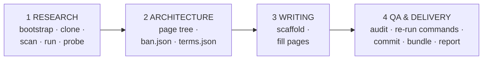

# GitHub Wiki LLM Writer

Turn a repository URL into a publication-ready GitHub Wiki where **every claim is
either traced to a source line or reproduced by executing the software.**

## When to use this skill

Use it when the task is any of:

- "write a wiki for `<repo>`"
- "create documentation pages for this project"
- "produce a multi-page GitHub Wiki with architecture, configuration reference,
  security hardening, and troubleshooting"
- "audit/improve an existing wiki for accuracy"

Do **not** use it for a single README rewrite, an API doc generation from source
comments, or prose editing — those do not need the four-phase pipeline.

## The one rule

> A claim enters the wiki only if it is **(a) traced to a source line**, or
> **(b) reproduced by running the software**.

This is not a stylistic preference. In the reference run that produced this kit,
the subject's own README claimed "syntax highlighting" (no highlighter existed
anywhere in the repository) and "nested lists" (they rendered as literal text).
Both claims were plausible, both were easy to transcribe, and both would have
shipped as falsehoods that any reader could disprove in two minutes.

Reading code tells you what software *intends*. Running it tells you what it
*does*. The gap between those two is where every interesting finding lives.

## Workflow

Four phases. Do not skip or reorder them; each one makes the next cheap.



### Phase 1 — Research (~40% of the effort)

```bash
bash setup/bootstrap.sh                                  # environment + capability report
git clone <REPO_URL> workspace/repo/SUBJECT
python3 scan/repo_scan.py workspace/repo/SUBJECT --brief -o workspace/research/scan.json
python3 probe/webapp_probe.py --repo workspace/repo/SUBJECT \
        --copy '<runtime files>' --entry <path> --suite generic \
        -o workspace/research/probe.json --md workspace/research/probe.md
```

`repo_scan.py --brief` replaces an hour of manual grepping: git metadata
(**including whether tags/releases exist**, which changes how versioning must be
documented), license type and extra attribution clauses, declared dependencies
*or their notable absence*, largest files, entry points, version markers, every
external host (supply-chain and privacy facts), security-signal counts, and the
configuration-key surface.

`webapp_probe.py` stages a clean throwaway instance on a verified-free port and
fires the whole battery: request modes, 20 path-traversal payloads, 26 injection
payloads, config-flag gating, upload filename validation, API status codes,
response-header inventory, and what the app wrote to disk.

Then read source **in ranges** (`sed -n '661,760p' file`), never `cat` a large
file. Start with header docblocks — they often contain a prose changelog with the
reasoning behind decisions.

**Write these five files before moving on.** They are the recovery point if
context is compacted, and they are what Phase 3 works from:

| File | Contents |
|---|---|
| `research/summary.md` | what it is, the problem, architecture in one paragraph, security posture, *measured* feature support, competitive position |
| `research/architecture.md` | component map, request lifecycle, module breakdown, config resolution, function index **with line numbers** |
| `research/domain-notes.md` | spec/standards context, security domain, deployment context, **and the canonical glossary** |
| `research/facts.json` | machine-readable facts; every value carries `source` (`code:file:line` \| `readme` \| `git` \| `test:name` \| `web:url`) |
| `research/sources.md` | A source-line citations · B named empirical tests · C external sources · **D claims deliberately NOT made, with reasons** |

Section D is the most valuable thing you will write. It becomes `ban.json` in
Phase 2, and it is what stops a future pass from "helpfully" re-adding a
plausible falsehood.

Before writing any probe code, read [`setup/PITFALLS.md`](setup/PITFALLS.md). Its
first three entries produce **silently wrong results**, which is worse than a
crash: a port collision makes your tests hit a stale server; a file named
`http.py` breaks every `urllib` call; anything in `/tmp` does not persist.

### Phase 2 — Wiki architecture (~3%, but do not skip)

Design the page tree **before** writing prose. Record it in `PROGRESS.json`
(start from `templates/PROGRESS.json.tmpl`): page list, groupings, style
contract, `do_not_claim`.

```bash
cp templates/ban.json   workspace/ban.json     # from sources.md section D
cp templates/terms.json workspace/terms.json   # from the domain-notes glossary
```

In `terms.json` the valuable half is the **banned synonyms** list: the real
failure mode is not wrong terminology, it is five terms for one concept. Keep
those patterns *narrow* — see PITFALLS D6.

### Phase 3 — Writing (~45%)

```bash
python3 scaffold/new_page.py workspace/wiki/OWNER.REPO.wiki --init \
    --project "<NAME>" --repo-url <REPO_URL> --version <V> --commit <SHA> \
    --pages "Home,Getting Started,..."
```

The scaffold already satisfies every structural rule the auditor enforces: H1,
lead-paragraph slot, `## Contents` with **correctly computed anchors**, and
`## See also`. Structure is free when scaffolded and expensive when retrofitted.

**Filename rule — get this wrong and every link dies.** GitHub maps spaces in a
wiki filename to hyphens in the URL, and resolves `[[Page Name]]` against that:

| File | URL | `[[Page Name]]` |
|---|---|---|
| `Security Hardening Guide.md` | `/wiki/Security-Hardening-Guide` | ✅ works |
| `Security-Hardening-Guide.md` | `/wiki/Security-Hardening-Guide` | ❌ dead |

Name files with **spaces**; link with the same spaces. `_Sidebar.md` and
`_Footer.md` keep their underscores (GitHub renders them on every page).

Write the two hardest pages first, while the research is fresh — usually the
security page and the reference matrix.

### Phase 4 — QA and delivery (~12%)

```bash
python3 qa/qa_wiki.py --self-test                 # proves the checker can fail
python3 qa/qa_wiki.py workspace/wiki/OWNER.REPO.wiki \
    --terms workspace/terms.json --ban workspace/ban.json --strict
```

Iterate to zero errors. Then **re-run the commands your wiki documents** in a
clean sandbox — in the reference run this caught two factual errors, including a
claim transcribed from the subject's README that the code did not implement.

```bash
bash publish/publish.sh workspace/wiki/OWNER.REPO.wiki OWNER/REPO
```

QA-gates, clones the `.wiki.git` repo (branch **`master`**, not `main`), commits,
produces a **verified bundle**, and prints three ways to publish. It never
prompts and never force-pushes. If the push fails for lack of credentials — the
usual case in a sandbox — that is expected and handled: hand over the commit, the
bundle, and `PUBLISH.md`.

Finish with `REPORT.md`: page inventory and word counts, what was verified and
how, the findings where the subject's own documentation is wrong, sources, and an
honest "what remains to be improved" section including the limits of your
analysis (which runtime version you actually used, what you could not execute,
what you reasoned from source rather than observed).

## Effort budget

From the reference run (22 files, 73 013 words, 0 QA errors):

| Phase | Share |
|---|---|
| Research | ~40% |
| Wiki architecture | ~3% |
| Writing | ~45% |
| QA + delivery | ~12% |

## Reference output

`examples/` contains artefacts from the completed reference run against
[paulmann/MD.Viewer](https://github.com/paulmann/MD.Viewer) — a self-hosted PHP
Markdown viewer: the research files, the probe evidence, and a sample of the
delivered pages. Use it to calibrate depth and house style.

## Files

| Path | Phase | Purpose |
|---|---|---|
| [`AGENTS.md`](AGENTS.md) | all | phase → tool mapping, tool reference, workspace discipline |
| [`PROMPT.md`](PROMPT.md) | — | the ready-to-paste task prompt (change only the repo URL) |
| [`setup/bootstrap.sh`](setup/bootstrap.sh) | 1 | idempotent environment setup + capability/egress report |
| [`setup/PITFALLS.md`](setup/PITFALLS.md) | 1 | the traps, ordered by time wasted |
| [`scan/repo_scan.py`](scan/repo_scan.py) | 1 | whole-repo inventory → JSON + brief |
| [`lib/req.py`](lib/req.py) | 1 | stdlib HTTP client returning status + headers + body |
| [`lib/serve.py`](lib/serve.py) | 1 | `ServedApp`: clean staged instance on a verified-free port |
| [`probe/webapp_probe.py`](probe/webapp_probe.py) | 1 | declarative batteries → evidence JSON + Markdown |
| [`scaffold/new_page.py`](scaffold/new_page.py) | 3 | QA-clean wiki skeleton or single page |
| [`qa/qa_wiki.py`](qa/qa_wiki.py) | 4 | the full audit, with `--self-test` |
| [`qa/fix_toc.py`](qa/fix_toc.py) | 3 | Rebuild a page's `## Contents` with GitHub slugs — block-scoped, `--bak`, word-count guard, `--self-test` reproducing the accident that ate a page |
| [`lib/session.py`](lib/session.py) | 1 | `SessionClient` (cookie jar, no auto-redirect) + `csrf_from_html` — probes stateful/admin surfaces that `req.py` cannot |
| [`qa/verify_commands.py`](qa/verify_commands.py) | 4 | Worked Phase-4 harness: fresh clone, then every documented command, with evidence JSON |
| [`lib/evidence.py`](lib/evidence.py) | 1,4 | `write_evidence()` retries into a fallback dir instead of losing probe evidence (PITFALLS B11) |
| [`setup/check_runtime.py`](setup/check_runtime.py) | 1 | Subject's declared runtime floor vs installed; exit 2 on mismatch |
| [`examples/run2-mdscribe/`](examples/run2-mdscribe/) | — | Second reference run: 1571-line battery, two layouts, stateful admin flow |
| [`setup/snapshot.sh`](setup/snapshot.sh) | all | Git-snapshot the workspace at phase boundaries, so a bad bulk edit costs minutes not hours |
| [`templates/REWORK-STATE.md.tmpl`](templates/REWORK-STATE.md.tmpl) | all | Recovery file: how to resume, environment rebuild, quirks, append-only log |
| [`publish/publish.sh`](publish/publish.sh) | 4 | QA gate → clone → commit → verified bundle |
| [`templates/`](templates/) | 2 | `terms.json`, `ban.json`, `STATE.md.tmpl`, `PROGRESS.json.tmpl` |

No dependencies beyond Python 3.8+ and `bash`.
