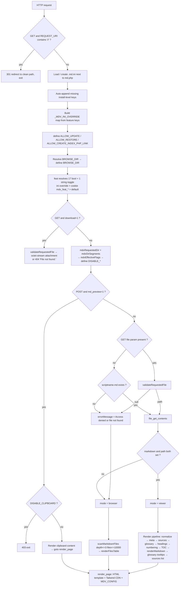
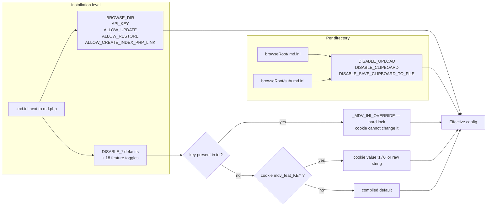
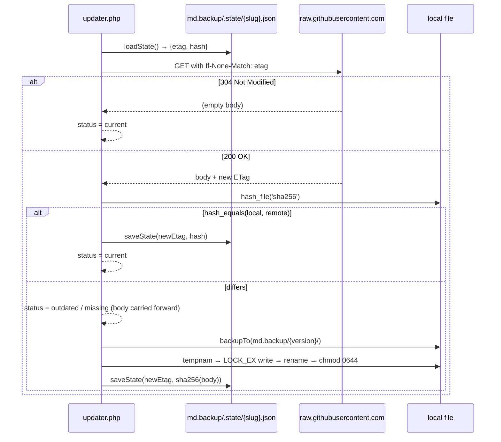

# architecture.md — MD.Viewer system decomposition

Source: `workspace/repo/MD.Viewer/` @ commit `85d3f54` (main), analysed 2026-10-14.

## 1. Component map

```
                      ┌──────────────────────────────────────────────┐
   Browser ──────────►│  md.php  (single entry point, v2.18.0)       │
                      │  ┌────────────────────────────────────────┐  │
                      │  │ 1. double-slash 301 normaliser (:322)  │  │
                      │  │ 2. .md.ini loader + auto-append (:380) │  │
                      │  │ 3. feat() toggle resolver (:512)       │  │
                      │  │ 4. raw-download short-circuit (:585)   │  │
                      │  │ 5. per-dir effective flags (:640)      │  │
                      │  │ 6. POST clipboard preview (:3484)      │  │
                      │  │ 7. file resolution → viewer | browser  │  │
                      │  │ 8. render pipeline → HTML template     │  │
                      │  └────────────────────────────────────────┘  │
                      └───────┬──────────────────────┬───────────────┘
                              │ assets               │ AJAX / form POST
                              ▼                      ▼
              css/md/*.css  js/md/*.js        ┌──────────────────────────────┐
                                              │ updater.php (v3.14.0)        │
              ┌───────────────────────────┐   │ RawFileUpdater class (:149)  │
              │ raw.githubusercontent.com │◄──┤ legacy actions + machine API │
              │  /paulmann/MD.Viewer/     │   │ same-origin guard (:2114)    │
              │  refs/heads/main          │   │ upload_md / save_clipboard   │
              └───────────────────────────┘   └──────────┬───────────────────┘
                                                         │
                                       md.backup/{version}/  md.backup/.state/*.json
                                       uploads.md/           index.php (hard link)
```

**Two PHP files. No classes in `md.php` (fully procedural). One class in `updater.php`
(`RawFileUpdater`, `final`). No autoloader, no Composer, no database, no sessions for
the viewer (only `sessionStorage` client-side for clipboard preview).**

## 2. Request lifecycle — `md.php`



## 3. Inline render pipeline (`inlineMarkdown()`, md.php:1956)

Uses four private-use-area code points as placeholder sentinels so that later regex
passes cannot corrupt earlier output:

| Code point | Holds | Restored at step | Escaped on restore? |
|---|---|---|---|
| `U+FFFC` | inline code span content | 12 | yes — via `e()` unless a universal pattern matches |
| `U+FFFD` | complete `` HTML | 11 | n/a — built with `e()` on src/alt/title |
| `U+FFFE` | **raw HTML tag matched by `/<\/?[a-zA-Z][^>]*>/u`** | 11b | **NO — verbatim** |
| `U+FFF9` | `_ * ~` inside link URLs | final `strtr` | n/a — re-inserted literally |

Order of operations: code spans → images → URL emphasis masking → **raw HTML capture** →
`e()` escape → emphasis/strong/del/mark → sub/sup → emoji → anchor links → absolute links →
reference links → source citations → footnote refs → restore images → **restore raw HTML** →
restore code spans → unmask URL chars.

> **Security consequence:** anything matching `<tagname …>` in the source Markdown is
> reproduced byte-for-byte in the output. This is the single largest risk surface of the
> project and is documented in `Security-Hardening-Guide.md`.

## 4. Configuration resolution



Precedence, highest first:

1. **Per-directory `.md.ini`** closest to the document (only the three `DISABLE_*` keys).
2. **Base `.md.ini`** — for those keys, plus all install-level keys and feature hard-locks.
3. **Cookie `mdv_feat_<NAME>`** set by the Settings panel — for feature toggles not present in `.md.ini`.
4. **Compiled default** in `md.php`.

`BROWSE_DIR` resolution order (first existing readable directory wins):
absolute value as-is → `$_SERVER['DOCUMENT_ROOT'] . '/' . value` → `__DIR__ . '/' . value`.
Rejected when > 255 bytes or containing a NUL byte.

Per-directory `.md.ini` is only read when `realpath()` of its directory is inside
`realpath(BROWSE_DIR)`; install-level keys found there are ignored and written to the
PHP error log.

## 5. Write paths (all in `updater.php`)

| Path | Trigger | Destination | Guards |
|---|---|---|---|
| Update / force reinstall | Settings panel AJAX `action=apply`, `?update=true`, machine API `install` | tracked paths under `docRoot()` | `ALLOW_UPDATE` (browser modes) or `API_KEY` (API); `writeBlockedReason()`; same-origin; atomic write |
| Self-update | `?update=true` phase 1 | `updater.php` itself | same as above + redirect to `?_phase=2` |
| Restore | `action=restore`, `?restore=latest\|X.Y.Z` | tracked paths | `ALLOW_RESTORE`; version regex `[a-zA-Z0-9.\-]`; creates `{version}-pre-restore` backup first; invalidates `.state/` |
| Backup | automatic before every replace | `md.backup/{localVersion}/…` | `README.md` and `LICENSE` excluded |
| Upload `.md` | `action=upload_md` (from `js/md/upload.js`) | requested `dir` → else `BROWSE_DIR` → else `uploads.md/` | `DISABLE_UPLOAD` for the effective directory; filename must end `.md`, no slashes, no NUL; `dir` traversal → 400 |
| Save clipboard | `action=save_clipboard` | same resolution as upload | `DISABLE_SAVE_CLIPBOARD_TO_FILE`; same filename rules |
| index.php link | `action=index_create` / `index_remove` | hard link `index.php` | `ALLOW_CREATE_INDEX_PHP_LINK`; 409 if a regular `index.php` exists |
| `.md.ini` creation | first request to `md.php` or `updater.php` | next to the script | writes safe defaults; appends missing keys with `FILE_APPEND \| LOCK_EX` |

`docRoot()` (updater.php:436) resolves to **the directory containing `updater.php`** when
`md.php` is present there, otherwise `$_SERVER['DOCUMENT_ROOT']` — the v3.10.1 fix for
subdirectory installs.

## 6. Update integrity model



**What SHA-256 does here:** detects that a download differs from the local copy, so a CDN
returning 200 for unchanged content does not cause a pointless rewrite.
**What it does not do:** prove authenticity. There is no signature, no pinned commit, no
checksum manifest published out-of-band. The trust anchor is TLS to
`raw.githubusercontent.com` plus whoever holds write access to `refs/heads/main`.
`CURLOPT_SSL_VERIFYPEER` is `true`; `CURLOPT_SSL_VERIFYHOST` is not set explicitly and
therefore uses the libcurl default (2 since libcurl 7.10.0).

## 7. Client-side modules

| File | Version | Responsibility |
|---|---|---|
| `js/md/md.js` | 2.7.0 | Mermaid lazy-load + auto-repair + English diagnostics; delegated `.copy-btn` handler for code/quote/document copy; table sorting (`data-sort-default`, date columns newest-first on first click); image fallback reveal |
| `js/md/settings.js` | 2.11.0 | Settings panel: reads `MDV_CONFIG`, writes `mdv_feat_*` cookies, drives updater AJAX (check/apply/restore/backups/index), default-sort preference (browser-only, never a server key) |
| `js/md/tooltips.js` | 2.4.5 | Glossary + feature tooltip engine: `.g-tooltip` bubble, viewport-aware placement, touch support, 2 s grace period |
| `js/md/upload.js` | 2.9.1 | Upload `.md` dialog → POST `action=upload_md` with `dir`; early-returns when `MDV_CONFIG.disableUpload`; keeps the real host in generated URLs |
| `css/md/md.css` | 2.2.2 | Document typography, code blocks, tables, task lists, footnotes, dark mode |
| `css/md/settings.css` | 2.9.0 | Settings panel chrome |
| `css/md/tooltips.css` | 2.4.5 | Tooltip bubble styling |

Mermaid is initialised with `securityLevel: 'loose'` and `htmlLabels: true`
(`js/md/md.js:292`) — diagrams may therefore contain HTML.

## 8. Data-at-rest layout produced at runtime

```
<install dir>/
├── md.php  updater.php  .md.ini  README.md  LICENSE
├── css/md/…  js/md/…
├── <scriptname>.md          # the default document
├── uploads.md/              # created on first upload/save when BROWSE_DIR is unset
├── index.php                # optional hard link, created on request
└── md.backup/
    ├── 2.18.0/              # one directory per local version replaced
    ├── 2.18.0-pre-restore/  # created before each rollback
    └── .state/
        └── {slug}.json      # {etag, hash, updated_at} per tracked file
```

## 9. Function index (`md.php`)

Config & security: `feat` 512 · `validateRequestedFile` 661 · `mdvInsideRoot` 785 ·
`mdvDirSegments` 801 · `mdvReadDirIni` 857 · `mdvEffectiveFlags` 926 · `mdvRequestedDir` 981

Browser: `scanMarkdownFiles` 1120 · `formatFileSize` 1221 · `formatDateTime` 1232 ·
`renderFilesTable` 1240

Utilities: `e` 1337 · `toStr` 1342 · `stripCodeBlocks` 1028 · `restoreCodeBlocks` 1101 ·
`slugify` 1675 · `cleanMetaText` 1516 · `resolveParagraphGlue` 2872 · `getHeadingClasses` 2860

Parsing: `normalizeMarkdown` 1353 · `extractMeta` 1407 · `extractFirstH1` 1475 ·
`parseSources` 1543 · `hasManualNumbering` 1594 · `parseReferenceLinks` 1703 ·
`parseFootnotes` 1755 · `parseUniversalPattern` 1810 · `renderUniversalElements` 1888 ·
`emojiMap` 1915 · `inlineMarkdown` 1956 · `isTableLine` 2221 · `parseTableRow` 2222 ·
`isAlignmentSeparator` 2223 · `parseTableAlignments` 2224 · `renderTable` 2226 ·
`collectHeadings` 2267 · `assignHeadingNumbers` 2357 · `renderTOC` 2386 ·
`isMermaidLanguage` 2402 · `renderCopyButton` 2409 · `normalizeMermaidLine` 2430 ·
`normalizeMermaidSource` 2486 · `renderCodeBlock` 2505 · `renderSourcesList` 2532 ·
`glossaryPlainText` 2570 · `expandGlossaryAliases` 2588 · `parseGlossaryTables` 2626 ·
`applyGlossaryTooltipsToHtml` 2724 · `renderFootnotes` 2820

Top level: `renderMarkdown` 2912 · `removeReferenceLinkDefinitions` 3319 ·
`removeFootnoteDefinitions` 3369 · `removeSourcesSection` 3449 · main block 3476+ ·
`render_page:` label 3517

## 10. Function index (`updater.php`)

Paths & config: `docRoot` 436 · `readIni` 453 · `localPath` 567 · `browseDirValue` 581 ·
`resolveBrowseDir` 616 · `destinationDir` 657 · `writeRoot` 936 · `backupRoot` 1013 ·
`backupDir` 1018 · `stateDir` 1024 · `stateFile` 1029 · `rawUrl` 1036

Guards: `requireAllowUpdate` 543 · `requireAllowRestore` 551 · `requireAllowIndexLink` 559 ·
`insideRoot` 731 · `dirSegments` 748 · `dirIniValues` 808 · `effectiveFlags` 877 ·
`requestDirSegments` 957 · `dirInRoot` 991 · `sameOriginViolation` 2114 ·
`requireSameOrigin` 2139 · `hostFromUrl` 2087 · `requestHost` 2097

Versioning & I/O: `extractVersion` 1041 · `localVersion` 1049 · `backupFile` 1060 ·
`atomicWrite` 1070 · `makeUpdater` 1080 · `mdViewerVersion` 1150

Machine API: `jsonError` 1090 · `generateApiKey` 1105 · `apiKeyFromRequest` 1111 ·
`jsonApiRequested` 1123 · `apiParam` 1133 · `isTruthy` 1141 · `installManifest` 1157 ·
`isManagedFile` 1170 · `writeBlockedReason` 1187 · `indexTargetFileNames` 1207 ·
`detectInstallConflicts` 1262 · `conflictCounts` 1302 · `conflictSummary` 1313 ·
`installDecision` 1332 · `apiStep` 1364 · `elapsedMs` 1370 · `jsonApiSend` 1399 ·
`handleJsonApi` 1416 · `jsonApiDispatch` 1446 · `jsonApiStatus` 1512 ·
`jsonApiConflicts` 1557 · `jsonApiInstall` 1585

Actions: `doVersion` 2209 · `doBackups` 2215 · `doCheck` 2245 · `doApply` 2302 ·
`doRestore` 2352 · `indexPath` 2412 · `indexIsLinked` 2421 · `doIndexStatus` 2429 ·
`doIndexCreate` 2447 · `doIndexRemove` 2476 · `doUploadMd` 2491 · `doSaveClipboard` 2591

HTML output: `outputUpdatePage` 1965; browser-mode dispatcher around 1744–1960.
