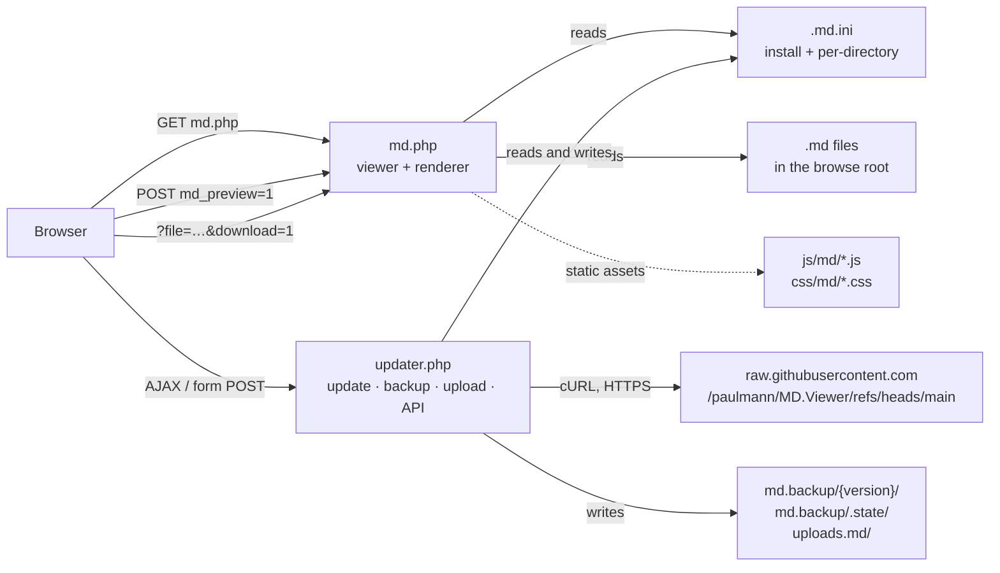

# MD.Viewer


**MD.Viewer is a self-hosted Markdown viewer and file browser written in plain PHP.** Copy
two files next to a folder of `.md` documents, open `md.php` in a browser, and the
documents are published: server-rendered HTML with an automatic table of contents,
hierarchical heading numbering, Mermaid diagrams, glossary tooltips, footnotes, reference
links, dark mode and responsive reading controls. There is no build step, no database, no
framework and no Composer dependency. A companion `updater.php` adds self-updating from
GitHub with versioned backups, one-command rollback, `.md` uploads and a key-protected
JSON API for installers.

Everything server-side is controlled by a single `.md.ini` file that the application
creates on first request and keeps up to date by appending any missing key, so upgrading
never requires manual configuration edits.

> [!IMPORTANT]
> MD.Viewer passes **raw HTML in Markdown through to the page unescaped**, and it sends no
> `Content-Security-Policy` header. It is designed for documents the operator controls.
> Do not point it at Markdown that untrusted users can write, and read the
> [[Security Hardening Guide]] before exposing an instance to a network you do not fully
> trust. Path traversal defence, by contrast, is thorough and was verified to hold.

---

## Contents

- [Key features](#key-features)
- [Quick start — five minutes](#quick-start--five-minutes)
- [How it is put together](#how-it-is-put-together)
- [Requirements](#requirements)
- [Wiki navigation](#wiki-navigation)
- [Project facts](#project-facts)

---

## Key features

**Rendering**

- Server-side Markdown → HTML: headings, paragraphs, emphasis, strong, strikethrough,
  `==highlight==`, `~sub~`/`^sup^`, inline code, blockquotes with a copy control, thematic
  breaks, fenced code blocks, tables with column alignment, task lists, images with a
  graceful fallback, footnotes, reference-style links, 16 emoji shortcodes.
- Automatic **table of contents** and automatic **hierarchical heading numbering** that
  steps aside when a heading is already numbered by hand.
- **Mermaid** diagrams: `mermaid`/`mmd` fenced blocks are lazy-loaded from a CDN only when
  a diagram is present, with an auto-repair pass and English-only console diagnostics.
- **Glossary tooltips**: any Markdown table whose first column has a header becomes a term
  list; terms get hover tooltips everywhere in the document, with touch support and
  viewport-aware placement.
- **Source citations**: a `## Sources` list is lifted out of the body and re-rendered as a
  styled reference section; `[[1,2]]` in prose becomes linked superscripts.

**Browsing and reading**

- A recursive, searchable **file browser** with sortable columns (File, Dir, Created,
  Modified, Size) that appears automatically when the matching document does not exist.
- **Copy** and **download** controls for the document being read and for every row of the
  browser; downloads are served as opaque `application/octet-stream` attachments.
- **Clipboard preview**: paste Markdown, render it, optionally save it to a file. Nothing
  is written unless the server configuration allows it.
- Dark mode, three page widths, font-size and line-height controls, per-device toolbar
  visibility, and a Settings panel whose choices persist in the browser.

**Operating**

- **Self-updater** with ETag + SHA-256 change detection, atomic writes, a pre-write guard
  that refuses to clobber files it does not recognise, versioned backups and rollback.
- **Machine JSON API** (`status`, `conflicts`, `install`) behind an `API_KEY`, so a control
  panel or installer can drive deployment and render progress step by step.
- **Per-directory `.md.ini`**: a subdirectory can enable or forbid uploads and clipboard
  saving for itself without touching the installation-level configuration.
- **`BROWSE_DIR`**: install the viewer in one directory and let it publish documents that
  live in another.

---

## Quick start — five minutes

### 1. Get the files

```bash
git clone https://github.com/paulmann/MD.Viewer.git /var/www/html/docs
cd /var/www/html/docs
```

Or, if you cannot use Git, download the repository archive and copy `md.php`,
`updater.php`, `js/` and `css/` into your target directory.

### 2. Create the matching document

The viewer derives its default document name from its own script name: `md.php` renders
`md.md`.

```bash
printf '# Hello, World\n\nThis is my documentation.\n\n## A second heading\n\nSo the table of contents appears.\n' > md.md
```

### 3. Serve it

```bash
php -S localhost:8080
```

```text
[Thu Oct 16 09:12:04 2026] PHP 8.3.14 Development Server (http://localhost:8080) started
```

### 4. Open the page

```text
http://localhost:8080/md.php
```

You should see a rendered document with a hero title, a "Table of content" panel and a
header toolbar. On that first request MD.Viewer also wrote `.md.ini` next to `md.php`:

```ini
; MD.Viewer server-side configuration
; Edit this file to hard-override settings.
; Changes here cannot be undone from the Settings panel.

DISABLE_UPLOAD    = true
DISABLE_CLIPBOARD = false
DISABLE_SAVE_CLIPBOARD_TO_FILE = true
ALLOW_UPDATE = false
ALLOW_RESTORE = false
ALLOW_CREATE_INDEX_PHP_LINK = true
; BROWSE_DIR = /share/
```

### 5. Check the browser mode

Delete or rename `md.md` and reload the same URL. Instead of a 404 you get the recursive
Markdown file browser for the whole directory tree.

> [!TIP]
> Want a second, independent viewer in the same tree? Copy `md.php` to `guide.php` and
> create `guide.md`. Each script name resolves its own document, with no routing
> configuration at all.

> [!NOTE]
> The page loads Tailwind CSS from `cdn.tailwindcss.com`, fonts from `fonts.googleapis.com`
> and (only when a diagram is present) Mermaid from `cdn.jsdelivr.net`. The **reader's**
> browser needs internet access, or you must self-host those assets. See
> [[Performance and Caching]].

**Next:** [[Getting Started]] walks through the same install on a real web server, and
[[Installation and Deployment]] covers Apache, Nginx, IIS and Caddy.

---

## How it is put together



Two PHP entry points, eleven tracked files, no database, no build artefacts. Full detail
in [[Architecture]].

---

## Requirements

| Requirement | Detail |
|---|---|
| PHP | **8.3 or newer** is the documented target. The version requirement is documented, not enforced at runtime — there is no `version_compare()` guard in either script. |
| PHP extensions | `mbstring` (rendering) and `curl` (updater; `RawFileUpdater` throws `RuntimeException('The cURL extension is required.')` without it) |
| Web server | Apache, Nginx, Caddy, IIS, or the PHP built-in server for testing |
| Writable paths | The install directory (`.md.ini`), `md.backup/` including `.state/`, and `uploads.md/` or `BROWSE_DIR` |
| Outbound HTTPS | Only for updates, to `raw.githubusercontent.com` |
| Reader's browser | Internet access for the Tailwind, Google Fonts and Mermaid CDNs unless you self-host them |
| Database | none |
| Build tooling | none |

---

## Wiki navigation

**Overview**

| Page | What it covers |
|---|---|
| [[Getting Started]] | The five-minute path, plus a production-shaped first install |
| [[Features and Live Demo]] | The verified feature inventory with input → rendered output samples |
| [[Comparison with Alternatives]] | MD.Viewer against docsify, MkDocs and Docusaurus |

**Install and configure**

| Page | What it covers |
|---|---|
| [[Installation and Deployment]] | Apache, Nginx, IIS, Caddy, built-in server, permissions, one-file bootstrap |
| [[Configuration Reference]] | Every `.md.ini` key and every feature toggle: default, effect, example |
| [[Settings Panel]] | The browser-side panel, cookies, and how hard locks interact with it |

**Authoring**

| Page | What it covers |
|---|---|
| [[Markdown Extensions Matrix]] | What the renderer supports, what it does differently, what it does not do |
| [[Authoring Guide]] | TOC, numbering, sources, citations, glossary tables, universal patterns, emoji |
| [[File Browser and Routing]] | The four request modes, `?file=`, the naming rule, `BROWSE_DIR` |

**Operating**

| Page | What it covers |
|---|---|
| [[Self-Updater Guide]] | Four update paths, two-phase bootstrap, force reinstall, backups, rollback, integrity |
| [[Machine API]] | The JSON installer API: envelope, actions, HTTP codes, worked `curl` session |
| [[File Upload and Clipboard]] | Upload rules, the `dir` parameter, Save to File, clipboard preview |
| [[Security Hardening Guide]] | Threat model, verified findings, CSP, reverse-proxy hardening, checklists |
| [[Performance and Caching]] | Where time goes, and the levers that exist |

**Reference**

| Page | What it covers |
|---|---|
| [[Architecture]] | Request flow, render pipeline, module map, function index |
| [[Troubleshooting]] | Symptom → cause → fix, including every HTTP status the code can return |
| [[FAQ]] | Short answers |
| [[Changelog and Versioning]] | Component versioning policy and release history |
| [[Glossary]] | Canonical terminology used across this wiki |

---

## Project facts

| | |
|---|---|
| Repository | https://github.com/paulmann/MD.Viewer |
| Project version | 2.11.3 (`README.md` version; components are versioned independently) |
| Components | `md.php` v2.18.0 · `updater.php` v3.14.0 · `md.js` v2.7.0 · `settings.js` v2.11.0 · `tooltips.js` v2.4.5 · `upload.js` v2.9.1 · `md.css` v2.2.2 · `settings.css` v2.9.0 · `tooltips.css` v2.4.5 |
| Author | Mikhail Deynekin — [Deynekin.com](https://Deynekin.com) |
| License | MIT, with an attribution clause requiring the copyright notice, the permission notice and the repository link in all copies |
| Dependencies | none (no Composer, no npm, no database) |
| Tracked files | 11 (checked, downloaded and backed up by the updater) |

> [!NOTE]
> The repository publishes **no Git tags and no GitHub Releases**. Version numbers live in
> the ` * Version: X.Y.Z` comment at the top of each file and in the tracked-file list.
> The updater reads that comment from the first 1000 bytes of each file. See
> [[Changelog and Versioning]].

---

## See also

- [[Getting Started]] — install it properly
- [[Security Hardening Guide]] — read this before exposing an instance
- [[Configuration Reference]] — every knob, with defaults
- [[Architecture]] — how a request becomes a page
- [[Glossary]] — the terminology used throughout this wiki
