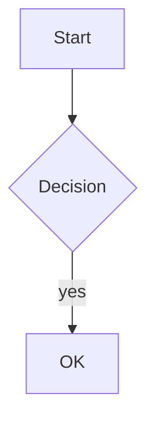

# Markdown Extensions Matrix

MD.Viewer ships its own renderer: a set of regular-expression passes plus a block-level
state machine in `renderMarkdown()`. It is **not** a CommonMark or GFM implementation, and
it does not claim conformance. This page is the measured reference — every row was produced
by feeding the input to a running viewer and inspecting the HTML that came back.

Use it to decide what you can safely write. Where a row says "divergent", the renderer
produces output that a CommonMark-conformant reader would not.

## Contents

- [How to read this matrix](#how-to-read-this-matrix)
- [Support summary](#support-summary)
- [Block elements](#block-elements)
- [Inline elements](#inline-elements)
- [Links, images and references](#links-images-and-references)
- [MD.Viewer extensions](#mdviewer-extensions)
- [Known divergences from CommonMark](#known-divergences-from-commonmark)
- [Not supported](#not-supported)
- [Raw HTML](#raw-html)
- [Escaping and sanitisation behaviour](#escaping-and-sanitisation-behaviour)
- [Authoring rules of thumb](#authoring-rules-of-thumb)
- [See also](#see-also)

---

## How to read this matrix

Each entry shows the Markdown you type, the HTML the viewer emits (classes abbreviated for
readability), and the toggle that governs it. "Governed by `—`" means always on.

The renderer works in two phases. Block structure is handled by a line-scanning state
machine in `renderMarkdown()`; inline content then passes through `inlineMarkdown()`,
which protects code spans, images and raw HTML with private-use-area placeholder code
points, escapes everything else with `htmlspecialchars(ENT_QUOTES | ENT_SUBSTITUTE)`,
applies the inline passes, and restores the placeholders.

| Code point | Holds | Escaped when restored? |
|---|---|---|
| `U+FFFC` | inline code span | yes, via `e()` |
| `U+FFFD` | generated `` | n/a — built with escaped attributes |
| `U+FFFE` | **raw HTML tag** | **no — verbatim** |
| `U+FFF9` | `_ * ~` masked inside link URLs | n/a — re-inserted literally |

---

## Support summary

| Area | Status |
|---|---|
| ATX headings, paragraphs, emphasis, code spans, blockquotes, thematic breaks | Supported |
| Fenced code with backticks, including length-aware nesting | Supported |
| Tables with alignment | Supported (GFM-style) |
| Task lists | Supported (GFM-style) |
| Footnotes, reference links | Supported |
| Heading numbering, TOC, source citations, glossary tooltips, universal patterns, emoji | MD.Viewer extensions |
| Nested lists | **Not supported** |
| Indented (4-space) code blocks | **Not supported** |
| Tilde fences `~~~` | **Not supported** by the body renderer |
| Autolinks (bare URLs, `<https://…>`) | **Not supported** |
| Backslash escapes | **Not supported** |
| HTML entity / numeric character references | **Divergent** — escaped, not decoded |
| Setext headings | **Divergent** — text is emitted twice |
| Raw HTML | **Passed through unescaped** — see [[Security Hardening Guide]] |

---

## Block elements

### ATX headings

```markdown
# Level one
## Level two
### Level three
#### Level four
##### Level five
###### Level six
```

```html
<h1 id="level-one" class="text-3xl sm:text-4xl font-bold …">
  <span class="heading-number …">1.</span>Level one</h1>
<h2 id="section-one" class="text-2xl sm:text-3xl font-semibold … border-b …">
  <span class="heading-number …">1.</span>Level two</h2>
```

- Slugs are generated by `slugify()`; duplicates are deduped with a `-2`, `-3` suffix.
- Levels map to distinct class sets via `getHeadingClasses()`.
- Governed by `AUTO_NUMBERING` for the numeric prefix.

> [!NOTE]
> In viewer mode the document's **first H1 is removed from the body** and re-rendered by the
> page template as the hero title. Numbering therefore starts at the remaining headings.
> See [[Authoring Guide]].

### Paragraphs and line breaks

```markdown
First paragraph.

Second paragraph.
```

```html
<p>First paragraph.</p>
<div class="paragraph-gap" aria-hidden="true"></div>
<p>Second paragraph.</p>
```

Governed by `DOUBLE_LINE_BREAKS` and `PARAGRAPH_BREAK_STYLE`
(`double-br` | `single-space` | `margin`).

### Blockquotes

```markdown
> Quoted line one
> Quoted line two
>
> Second paragraph in the quote
```

```html
<blockquote class="border-l-4 border-blue-500 pl-4 py-2 my-4 bg-slate-50/50 … rounded-r-lg">
  <p>Quoted line one<br> Quoted line two</p>
  <p>Second paragraph in the quote</p>
  <button type="button" class="copy-btn … quote-copy-btn" aria-label="Copy quote to clipboard">…</button>
</blockquote>
```

Soft line breaks inside a quote become `<br>`. Every blockquote gets a copy control.

> [!NOTE]
> Lazy continuation lines (`> line1` followed by an unquoted `line2`) are merged into the
> same paragraph rather than ending the quote.

### Fenced code blocks

````markdown
```php
<?php echo "hi";
```
````

```html
<div class="code-block-wrapper group my-8 overflow-hidden rounded-2xl …">
  <div class="code-block-header …">
    <span class="… uppercase …">PHP</span>
    <button type="button" class="copy-btn …" aria-label="Copy code to clipboard">…</button>
  </div>
  <div class="overflow-x-auto px-5 py-4 sm:px-6">
    <pre class="text-sm leading-6"><code class="language-php …">&lt;?php echo &quot;hi&quot;;</code></pre>
  </div>
</div>
```

- The info string becomes both a visible uppercase language label and a
  `language-<info>` class.
- Content is HTML-escaped.
- **Length-aware fencing works correctly**: a four-backtick fence wrapping a three-backtick
  fence renders as a single block containing the inner fence literally.
- Every code block gets a copy control.

> [!WARNING]
> **No syntax highlighting is applied.** The repository loads no highlighter — a
> repo-wide search for external asset URLs finds only Tailwind, Google Fonts and Mermaid.
> Code is styled by `css/md/md.css` as monospace on a dark slab. The upstream README
> mentions "syntax highlighting" among its CDN requirements; that is inaccurate and this
> wiki does not repeat it.

> [!CAUTION]
> **Tilde fences are not rendered as code blocks.** `~~~js … ~~~` appears as literal
> paragraph text. The fence-stripping helpers accept `` ` `` and `~`, but the body renderer
> did not produce a code block for tildes in testing. **Always use backticks.**

### Tables

```markdown
| Left | Center | Right |
|:-----|:------:|------:|
| a    | b      | c     |
```

```html
<div class="my-8 overflow-hidden rounded-3xl border … bg-white/80 …">
 <div class="overflow-x-auto">
  <table class="min-w-full border-collapse text-left text-sm …">
   <thead class="bg-slate-950 text-white dark:bg-slate-800"><tr>
    <th scope="col" class="… text-left">Left</th>
    <th scope="col" class="… text-center">Center</th>
    <th scope="col" class="… text-right">Right</th>
   </tr></thead>
   <tbody class="divide-y …">
    <tr class="bg-white/70 … hover:bg-slate-100/80 … transition">
     <td class="… text-left" data-gc="1">a</td>
     <td id="gd-tbl-1-0-1" class="… text-center">b</td>
     <td id="gd-tbl-1-0-2" class="… text-right">c</td>
    </tr>
   </tbody>
  </table>
 </div>
</div>
```

- `:---`, `:---:`, `---:` produce `text-left`, `text-center`, `text-right` on both header
  and body cells.
- The alignment separator row is optional in the source — a two-line table still renders.
- Cells in the first column carry `data-gc="1"`; other cells carry an
  `id="gd-tbl-N-row-col"` used by the glossary tooltip engine.
- Leading and trailing pipes are optional in the parser (`parseTableRow()` strips them).

> [!IMPORTANT]
> **Any table whose first column has a non-empty header is treated as a glossary.** Its
> first-column values become tooltip terms matched across the whole document. A table of
> short or numeric values will therefore produce surprising tooltips elsewhere. See
> [[Authoring Guide]] for how to control this.

### Task lists

```markdown
- [ ] open item
- [x] closed item
```

```html
<ul class="task-list space-y-2">
  <li class="flex items-start gap-3">
    <input type="checkbox" class="…"><span class="flex-1">open item</span></li>
  <li class="flex items-start gap-3 task-done">
    <input type="checkbox" checked disabled class="…"><span class="flex-1">closed item</span></li>
</ul>
```

Governed by `FEATURE_TASK_LISTS`. Completed items get `checked disabled` and a `task-done`
class. Checkboxes are never interactive — this is a reader, not an editor.

### Lists

```markdown
1. one
2. two

- bullet a
- bullet b
```

```html
<ol start="1" class="space-y-1 list-decimal list-inside">
  <li value="1">one</li><li value="2">two</li>
</ol>
<ul class="space-y-1"><li>bullet a</li><li>bullet b</li></ul>
```

An ordered list's first number is preserved as `start` and each item carries `value`.

> [!CAUTION]
> **Nested lists do not work.** Indented children are not parsed as sublists:
>
> ```markdown
> - top
>   - child
> ```
>
> renders as `<ul><li>top</li></ul>` followed by a **paragraph containing the literal text**
> `- child`. Four-space indentation fares no better — the child becomes a stray `<p>`.
> The upstream README lists "nested lists" as supported; testing contradicts this.
> **Flatten your lists**, or express hierarchy with headings and tables.

### Thematic breaks

```markdown
---
***
___
```

```html
<hr class="my-8 border-slate-200 dark:border-slate-700">
```

All three characters work.

### Mermaid diagrams

````markdown

````

```html
<div class="code-block-wrapper …">
  <div class="code-block-header …"><span …>MERMAID</span><button class="copy-btn …">…</button></div>
  <div class="overflow-x-auto px-5 py-4 sm:px-6">
    <pre class="mermaid text-slate-200 font-mono">graph TD
  A[Start] --&gt; B{Decision}
  B --&gt;|yes| C[OK]</pre>
  </div>
</div>
```

PHP emits the **source** in a `<pre class="mermaid">`. `js/md/md.js` then, only if at least
one such element exists, dynamically imports Mermaid 11 from
`https://cdn.jsdelivr.net/npm/mermaid@11/dist/mermaid.esm.min.mjs` and runs it. Info strings
`mermaid` and `mmd` are both recognised.

Client-side behaviour worth knowing:

- An **auto-repair** pass normalises common authoring mistakes before parsing:
  PlantUML-style class notes, literal `\n`, unclosed `<br>`, PlantUML `return`, unquoted
  parentheses.
- Diagnostics are **English-only** and written to the console.
- On a parse failure the element gets `mermaid-error` and `data-mermaid-error="true"`.
- The original source is preserved in `data-mermaid-source`, and the copy control returns
  that source rather than the rendered SVG.
- Mermaid is initialised with `securityLevel: 'loose'` and `htmlLabels: true`.

> [!WARNING]
> `securityLevel: 'loose'` permits HTML inside diagram labels and enables click callbacks.
> For untrusted diagram source this is an additional script-capable surface on top of the
> raw-HTML issue. See [[Security Hardening Guide]].

---

## Inline elements

| Input | Output | Toggle |
|---|---|---|
| `**bold**` | `<strong>bold</strong>` | — |
| `__bold__` | `<strong>bold</strong>` | — |
| `*italic*` | `<em>italic</em>` | — |
| `_italic_` | `<em>italic</em>` | — |
| `~~strike~~` | `<del>strike</del>` | — |
| `==highlight==` | `<mark>highlight</mark>` | — (not CommonMark or GFM) |
| `H~2~O` | `H<sub>2</sub>O` | `FEATURE_SUBSUP` |
| `x^2^` | `x<sup>2</sup>` | `FEATURE_SUBSUP` |
| `` `code` `` | `<code class="inline-code copy-on-click" title="Click to copy">code</code>` | — |
| `:rocket:` | 🚀 | `FEATURE_EMOJI` |

Inline code is click-to-copy: the `copy-on-click` class is served by one delegated handler
in `js/md/md.js`.

### Emoji shortcodes

The complete supported set — sixteen entries, no others:

| Shortcode | | Shortcode | | Shortcode | | Shortcode | |
|---|---|---|---|---|---|---|---|
| `:smile:` | 😊 | `:laughing:` | 😆 | `:joy:` | 😂 | `:heart:` | ❤️ |
| `:thumbsup:` | 👍 | `:thumbsdown:` | 👎 | `:warning:` | ⚠️ | `:error:` | ❌ |
| `:check:` | ✅ | `:x:` | ❌ | `:star:` | ⭐ | `:fire:` | 🔥 |
| `:bulb:` | 💡 | `:rocket:` | 🚀 | `:link:` | 🔗 | `:info:` | ℹ️ |

Any other `:shortcode:` is left as literal text.

> [!TIP]
> Because the map is small and fixed, prefer the literal emoji character in your source for
> anything outside this list. It renders identically and does not depend on a toggle.

---

## Links, images and references

### Inline links

```markdown
[Example](https://example.com)
[Anchor](#a-heading)
[Relative](docs/other.md)
```

```html
<a href="https://example.com" target="_blank" rel="noopener noreferrer" class="text-blue-600 …">Example</a>
<a href="#a-heading" class="text-blue-600 …">Anchor</a>
```

- Absolute `http(s)` links open in a new tab with `rel="noopener noreferrer"`.
- Anchors and relative paths render without `target`.
- `_`, `*` and `~` inside a URL are masked during emphasis processing and restored
  afterwards, so URLs containing underscores survive intact.

> [!NOTE]
> `[click](javascript:alert(1))`, `[click](data:text/html,…)` and URL-encoded variants are
> **not** turned into links — the inline-link passes only match `#…` or `https?://…`, so
> such input stays literal text. Reference-style links are the exception; see below.

### Reference-style links

```markdown
See [the specification][spec] and [Example][ex].

[spec]: https://spec.commonmark.org/
[ex]: https://example.org "Example Title"
```

```html
<a href="https://example.org" target="_blank" rel="noopener noreferrer"
   title="Example Title" class="text-blue-600 …">Example</a>
```

Governed by `FEATURE_REF_LINKS`. Keys are matched case-insensitively; an empty key
(`[text][]`) falls back to the text itself. Definitions are removed from the rendered body
by `removeReferenceLinkDefinitions()`. An unresolved reference renders as a greyed span:

```html
<span class="text-slate-400 dark:text-slate-500" title="Reference not found">[text]</span>
```

> [!CAUTION]
> **Reference-link URLs are not protocol-filtered.** A definition of
> `[r]: javascript:alert(1)` produces `<a href="javascript:alert(1)">`. The URL is escaped
> for attribute context but the scheme is never checked. This is a real XSS vector in
> documents an untrusted party can author — see [[Security Hardening Guide]].

### Images

```markdown


```

```html

<span class="hidden text-sm text-slate-500 dark:text-slate-400">Image: Badge</span>
```

Governed by `FEATURE_IMAGES`. Images are extracted **before** the escape pass so that a
linked badge `[](url)` is not double-wrapped in an anchor — a documented v2.2.4
fix. Consequences:

- All images are lazy-loaded and decoded asynchronously.
- A failed load hides the `` and reveals a fallback caption built from the alt text.
- Images are `inline-block`, so a row of badges flows on one line without `<br>` between
  them.
- `src`, `alt` and `title` are attribute-escaped, so `)`
  cannot break out of the attribute — it renders as literal text.

### Footnotes

```markdown
Text with a footnote[^note1].

[^note1]: This is the footnote body.
```

```html
<p>Text with a footnote<a href="#fn-fn-note1" id="fnref-fn-note1" class="footnote-ref"
   aria-label="Footnote note1" title="This is the footnote body.">
   <sup class="text-blue-600 dark:text-blue-400 font-semibold">[note1]</sup></a>.</p>
…
<section class="mt-16 pt-8 border-t …" aria-label="Footnotes">
  <h3 class="…">Footnotes</h3>
  <ol class="space-y-3 …">
    <li id="fn-note1" class="flex gap-2">
      <a href="#fnref-note1" class="footnote-backlink …" aria-label="Back to content">&#8617;</a>
      <span>This is the footnote body.</span></li>
  </ol>
</section>
```

Governed by `FEATURE_FOOTNOTES`. The reference carries a `title` with the first 100
characters of the note (tags stripped), and the closing section provides a backlink.
Definitions are removed from the body by `removeFootnoteDefinitions()`.

---

## MD.Viewer extensions

These have no CommonMark or GFM equivalent.

### Automatic heading numbering

`AUTO_NUMBERING` prefixes each heading with a hierarchical number rendered in a muted
monospace span, in both the body and the TOC:

```html
<span class="heading-number text-slate-400 dark:text-slate-500 mr-2 font-mono">1.2.</span>
```

`hasManualNumbering()` detects a number the author already wrote and suppresses the
automatic prefix for that heading, so numbering is never duplicated. Recognised manual
forms include `1. Title`, `2) Title`, `3: Title`, `2 Title`, `1.1 Subsection`,
`10.2.3. Deep`, `I. Intro`, `XIV. Chapter`. Explicitly **not** recognised: `2024 year`,
`101 Title`, `3D`, `5G`, `4K`, `№1 Title`, `Chapter 1`, or a bare ambiguous Roman letter
such as `M Title`.

### Automatic table of contents

`AUTO_TOC` renders a `<nav class="toc">` block titled "Table of content", placed between
the hero title and the article. Entries link to heading slugs and are indented per level
(`ml-0` … `ml-16`), with levels 1–2 emphasised.

> [!IMPORTANT]
> `renderTOC()` returns an empty string when fewer than **two** headings were collected.
> Because viewer mode strips the document's first H1 before collecting, a document needs at
> least two headings *in addition to* its H1 for a TOC to appear. A one-H1-and-one-H2
> document shows no TOC. This is the most common "why is my TOC missing" question — see
> [[Troubleshooting]].

### Source citations and the Sources List

A numbered list under a recognised heading is lifted out of the body and re-rendered as a
styled reference section:

```markdown
## Sources

1. **CommonMark Spec**
   - URL: https://spec.commonmark.org/
2. **GFM Spec**
   - URL: https://github.github.com/gfm/
```

Cite them inline with double brackets:

```markdown
As specified[[1,2]].
```

```html
<sup class="source-group">[<a href="https://spec.commonmark.org/" target="_blank"
  rel="noopener noreferrer" title="CommonMark Spec" class="source-ref">1</a>,<a
  href="https://github.github.com/gfm/" … class="source-ref">2</a>]</sup>
```

- Recognised headings (H1 or H2, optionally with a manual-number prefix, matched
  case-insensitively): `Sources List`, `Sources`, `Источники`, `Список источников`.
- The entry pattern is `N. **Title**` followed by a line `- URL: https://…`.
- The original section is removed from the body by `removeSourcesSection()`, which protects
  fenced code first so that a ```` ```markdown ```` example containing `## Sources` is not
  stripped.
- The generated list is gated by `AUTO_FOOTNOTES_LINKS`.
- An unknown citation id renders as `<span class="source-ref source-ref-missing">`.

### Glossary tooltips

Any table with at least two columns and a non-empty first-column header is parsed as a
glossary. Its first-column values become terms; occurrences elsewhere in the document are
wrapped:

```markdown
| Term | Definition |
|------|------------|
| Widget | A small device |

The Widget appears in prose.
```

```html
<p>The <span class="glossary-term" data-gterm="tbl-1:0:2">Widget</span> appears in prose.</p>
```

`js/md/tooltips.js` resolves `data-gterm="tbl-{table}:{row}:{cols}"` to the cell
`id="gd-tbl-{table}-{row}-{col}"` and shows its content in a `.g-tooltip` bubble. Matching
is word-boundary-safe using Unicode lookarounds, terms are sorted longest-first so a short
term cannot steal a longer one, and injection is suppressed inside `a`, `code`, `pre`,
`script`, `style`, `th` and first-column cells.

**Alias syntax:** a term written `Base term (ALIAS)` registers both `Base term` and
`ALIAS`, resolving variant spellings to one definition.

```markdown
| Term | Definition |
|------|------------|
| Neurofeedback (NF) | A closed-loop training method |

NF sessions last thirty minutes.
```

Both `Neurofeedback` and `NF` now produce tooltips pointing at the same cell.

> [!WARNING]
> The glossary heuristic is **structural, not semantic**. A table like
>
> ```markdown
> | A | B |
> |---|---|
> | 1 | 2 |
> ```
>
> registers `1` as a term, and every standalone `1` in the document outside protected
> context becomes a tooltip. Keep first-column values distinctive, or set
> `GLOSSARY_TOOLTIPS = false` for documents with many data tables.

### Universal patterns

An inline code span containing brackets, braces or arrows is parsed as a node/relationship
expression and rendered visually instead of as code. Governed by `UNIVERSAL_PATTERNS` and
`CYPHER_PATTERNS`; both must be on.

```markdown
`(User)-[auth]->(Server)`
```

```html
<span class="pattern-chain" role="group" aria-label="Pattern visualization">
  <span class="pattern-node" role="term">User</span>
  <span class="pattern-rel" role="link">
    <span class="pattern-line"></span>
    <span class="pattern-rel-label">auth</span>
    <span class="pattern-arrow">&rsaquo;</span>
    <span class="pattern-line"></span>
  </span>
  <span class="pattern-node" role="term">Server</span>
</span>
```

| Syntax | Element | Direction |
|---|---|---|
| `(Label)` | node | — |
| `(id:Label)` | node, label after the colon | — |
| `[Label]` | bracket node, or relationship when the span also contains an arrow | undirected |
| `{Label}` | curly node | — |
| `-->` | relationship | right |
| `<--` | relationship | left |
| `<-->` | relationship | bidirectional |
| `-[label]->` | labelled relationship | right |
| `--` | relationship | undirected |

A label may be `id:Label`; the part after the colon is displayed.

> [!NOTE]
> This pass is guarded against non-progress. A `<` or `>` that is not part of an arrow pair
> (as in `` `--basetemp=<path>` `` or `` `<T>` ``) used to leave the parse loop without
> consuming input, running to the PHP time limit and answering HTTP 500. v2.16.0 fixed it:
> the loop now breaks and the span falls back to a plain `<code>`.

---

## Known divergences from CommonMark

| Construct | CommonMark / GFM says | MD.Viewer does |
|---|---|---|
| Setext heading `Title` + `---` | one `<h2>Title</h2>` | `<p>Title</p>` **and** `<h2>Title</h2>` — the text appears twice |
| Hard break (trailing two spaces) | single `<br>` | `<br><br>` under the default `PARAGRAPH_BREAK_STYLE=double-br` |
| HTML entity `&amp;` | decoded to `&` | escaped to `&amp;amp;`, displayed as the text `&amp;` |
| Numeric reference `&#169;` | decoded to © | escaped to `&amp;#169;`, displayed as the text `&#169;` |
| Backslash escape `\*` | literal `*` | not honoured; `\*not emphasis\*` renders `<em>not emphasis\</em>` |
| Bare URL autolink | GFM makes it a link | literal text |
| `<https://example.org>` | autolink | literal text |
| Indented (4-space) code block | `<pre><code>` | a plain paragraph |
| Tilde fence `~~~` | fenced code | literal paragraph text |
| Nested lists | nested `<ul>`/`<ol>` | children become literal paragraph text |
| HTML comment `<!-- x -->` | passes through | passes through, and may break out of a `<p>` |

> [!TIP]
> Two of these have easy workarounds. For entities, type the literal character (`&`, `©`)
> instead of a reference — the source is UTF-8 throughout. For emphasis you need to show
> literally, wrap it in a code span rather than backslash-escaping it.

---

## Not supported

| Feature | Notes |
|---|---|
| Nested lists | Flatten, or use headings/tables for hierarchy |
| Indented code blocks | Use backtick fences |
| Tilde fences | Use backtick fences |
| Autolink literals | Write `[text](https://…)` explicitly |
| Angle-bracket autolinks | Same |
| Backslash escapes | Use code spans |
| Definition lists | Not a CommonMark feature either |
| HTML entity references | Type the character |
| Multi-level blockquotes (`>>`) | Not verified as nesting |
| Syntax highlighting | No highlighter is loaded |
| SmartyPants / smart quotes | Not implemented |
| Front matter (YAML/TOML) | Not parsed; it renders as body text |
| `<details>` from Markdown | Only via raw HTML, which is unsanitised |
| Math (`$…$`, `$$…$$`) | Not implemented |

---

## Raw HTML

Inline HTML matching `/<\/?[a-zA-Z][^>]*>/u` is captured before the escape pass and
restored **verbatim** afterwards.

```markdown
Write <b>this</b> in HTML.
```

```html
<p>Write <b>this</b> in HTML.</p>
```

This is CommonMark §6.10 behaviour — but CommonMark also states that sanitisation is the
host application's responsibility, and GFM §6.11 defines a "Disallowed Raw HTML" extension
for exactly this case. MD.Viewer implements neither, and GitHub itself sanitises after
conversion.

> [!CAUTION]
> Raw HTML passthrough means `<script>`, ``, `<svg onload=…>`,
> `<iframe src="javascript:…">` and `javascript:` reference links all reach the page
> intact. **MD.Viewer is safe for documents the operator trusts and unsafe for documents an
> untrusted third party can write.** Read [[Security Hardening Guide]] before deploying
> anywhere a stranger can influence content.

---

## Escaping and sanitisation behaviour

What the renderer *does* protect:

| Vector | Result |
|---|---|
| Plain text containing `<`, `>`, `&`, `"` | Escaped by `e()` = `htmlspecialchars(ENT_QUOTES \| ENT_SUBSTITUTE, 'UTF-8')` |
| Content inside a code span or fence | Escaped |
| Image `src`, `alt`, `title` | Attribute-escaped, so no attribute breakout |
| Inline-link target `[t](javascript:…)` | Not matched — stays literal text |
| Inline-link target `[t](data:…)` | Not matched — stays literal text |
| Link text in an absolute link | Escaped |
| Footnote id, title, source title/url | Escaped |
| File browser cells, paths, filenames | Escaped |
| Page title and meta description | Escaped |

What it does **not** protect:

| Vector | Result |
|---|---|
| Any raw HTML tag | Passed through verbatim |
| `on*` event attributes in raw HTML | Passed through |
| `javascript:` in a **reference-link** definition | Becomes a live `href` |
| HTML comments | Passed through |
| Mermaid diagram source | Rendered client-side with `securityLevel: 'loose'` |

---

## Authoring rules of thumb

1. **Use backtick fences**, never tildes, never indentation.
2. **Flatten lists.** Nesting does not render.
3. **Type literal characters** instead of HTML entities.
4. **Wrap anything you want shown literally in a code span** — backslash escapes do not work.
5. **Give your document at least two headings after the H1** or there will be no TOC.
6. **Keep glossary first-column values distinctive**, or disable `GLOSSARY_TOOLTIPS`.
7. **Write full link syntax** `[text](https://…)`; bare URLs are not linkified.
8. **Never rely on raw HTML for layout** in a document someone else might later edit — it is
   unsanitised.
9. **Use the `## Sources` convention** for references rather than hand-building a list; it is
   lifted, styled and citable with `[[1,2]]`.
10. **Test in the actual viewer.** A document that renders correctly on GitHub may not render
    correctly here, and vice versa. The clipboard preview makes this fast — see
    [[File Upload and Clipboard]].

---

## See also

- [[Authoring Guide]] — how to structure a document for this renderer: titles, TOC, sources, glossary
- [[Security Hardening Guide]] — the raw-HTML and reference-link findings in full, with mitigations
- [[Architecture]] — the render pipeline these passes belong to
- [[Configuration Reference]] — the toggles named throughout this page
- [[Troubleshooting]] — "my TOC is missing", "my list looks wrong"
- [CommonMark Spec](https://spec.commonmark.org/) and [GFM Spec 0.29-gfm](https://github.github.com/gfm/) — the standards this renderer is inspired by but does not implement
